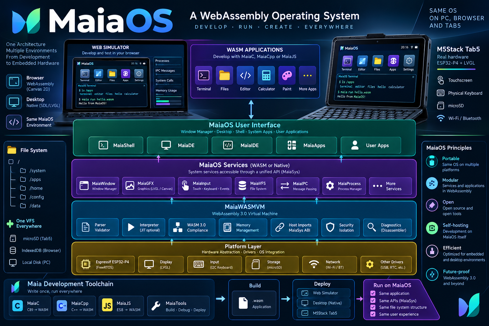

> **Updated architecture (2026-10-17):** [MaiaOS Architecture, Product Vision and Implementation Plan](docs/MAIAOS_ARCHITECTURE_VISION_2026.md). Includes simulator, keyboard, MaiaWASMVM, IPC, shell, windows and Mermaid diagrams.

# MaiaOS



**A WebAssembly-first, portable embedded application operating environment.**

MaiaOS is designed to run on desktop hosts during development and on the M5Stack Tab5 (ESP32-P4) in production. The initial OS kernel is written in freestanding C++98 and compiled to `kernel.wasm`; it calls only platform-neutral `maia.*` imports. The native device boot host supplies MaiaWASMVM, recovery, drivers, and native callbacks. In the browser, a wrapper temporarily uses the browser's native WebAssembly engine and JavaScript callbacks. The MaiaWASM VM remains a separate runtime project and will replace that browser reference engine when ready. The guest does not detect whether it is running in the browser or on the device.

> **Project status: browser simulator runs the C++98 WASM kernel plus Calculator, Clock and a separate I/O + shell session through LVGL-WASM.** App instances have separate memories, event queues, and `/home/<app-id>` VFS namespaces; the kernel remains running underneath app windows. Browser execution uses the native WebAssembly reference engine until MaiaWASMVM is ready. Physical Tab5/ESP-IDF work is intentionally deferred; `/tmp` remains volatile and browser `/home` plus `/shared` use IndexedDB.

## Design principles

1. Build and test on Linux/macOS/Windows first; move the same core and ABI to ESP-IDF.
2. Preserve the Espressif ROM/second-stage bootloader. Native platform firmware starts MaiaWASMVM and loads `/system/kernel.wasm` from microSD.
3. Keep the C++98 kernel guest independent of graphics, FreeRTOS, microSD, and ESP-IDF; keep the MaiaWASM VM/runtime as a separate layer.
4. Keep graphics, VFS, process, event, device and IPC APIs independent of their implementations.
5. Treat WASM modules as untrusted; validate, bound memory and CPU use, and mediate host calls.
6. Preserve ES8, C89, C++98 and WebAssembly 3.0 as suite targets, with an explicitly negotiated embedded feature profile.
7. Develop the interpreter in JS and verify generated C89 against identical conformance tests.
8. Generate every parser automatically from its EBNF using MaiaCC/tREx only. Never hand-write a replacement parser or manually edit generated parser code. Fix grammar or generator defects at their source; collectors and host adapters must not duplicate syntax rules.

## Guest artifacts and toolchain

The current system boot chain keeps the Espressif ROM and second-stage bootloader unchanged. The browser boot coordinator is `platform/desktop-web/main.js`; the native Tab5 platform firmware and boot host are planned. The target system artifact set is:

| Artifact | Status | Role |
|---|---|---|
| `kernel.wasm` | Implemented | C++98 kernel guest; current browser host starts it and schedules `maiaos_step`. |
| `io.wasm` | Bounded reference implementation | C++98 terminal service: LVGL, keyboard editing/history and canonical input over bounded streams. |
| `shell.wasm` | Bounded MVP | Generated C++98 lexer/parser in the guest; six simple commands through streams/VFS; I/O owns LVGL/events. Compound execution and POSIX conformance remain future work. |
| `desktop.wasm` | Planned | Graphical desktop/session and window-management guest. |

All MaiaOS WASM guests are built with the Maia Suite, not Emscripten. C++98 sources use MaiaCpp in AST-strict mode to emit C89, then MaiaC emits and validates WebAssembly using the in-repository MaiaWASM toolchain. MaiaCC generates parsers from EBNF. Emscripten is currently used only to build the separate LVGL-WASM browser platform module.

Initialize MaiaCpp and its nested MaiaC, MaiaCC and MaiaWASM dependencies before building:

```sh
git submodule update --init --recursive
npm run build:kernel
npm run build:apps
npm run build:io -- --check-c89
npm run build:shell -- --check-c89
```

The recursive submodule pointers pin the toolchain versions. `./git_pull.sh` is the repository helper for updating the parent and recursively synchronizing submodules.

## Quick start (desktop)

Requires Node.js 18+ for the prototype (not a target-runtime requirement).

```sh
npm test
npm run build:lvgl
npm run demo
```

Open http://localhost:8080 . The browser wrapper loads the LVGL-WASM host and C++98 kernel. The Applications selector reads `apps/catalog.json`; launch Maia Calculator or Maia Clock as separate WASM instances, and close either app to return to the still-running kernel window.

The simulator places the real 1280×720 LVGL display inside a responsive device
bezel. Choose an application (including Maia Shell MVP) and use **Run app**;
click the display to direct keyboard input to the guest. **Full screen** expands
the device where supported; Escape returns to the workspace. **Developer tools**
contains custom WASM/manifest loading and runtime diagnostics. Those controls
belong to the simulator; all applications inside the display are LVGL-rendered.

Launching the shell starts `io.wasm` and `shell.wasm` with separate memories while
the kernel keeps running. I/O owns LVGL terminal rendering and line editing; the
shell owns prompts, generated parsing and command execution. Bounded copied-byte
streams connect them. See the approved [Shell/I/O vertical slice](docs/planning/SHELL_IO_VERTICAL_SLICE.md)
and [ABI](docs/specifications/abi-v0.md). Reference integration checks:

```sh
npm run test:io-streams
npm run test:shell-host
npm run test:shell-lvgl
npm run test:shell-boot
```

Browser interaction/fullscreen/touch checks for this update remain unrun because
the integrated browser backend is unavailable; Node tests use actual guest WASM
and LVGL-WASM, without claiming device/MaiaWASMVM conformance.

To build the LVGL browser platform module, provide Emscripten (`EMSDK` defaults to `~/emsdk`) and run:

```sh
npm run build:lvgl
npm run test:lvgl-host
```

`npm run build:kernel` builds only `apps/kernel/kernel.cpp` to a standalone `kernel.wasm` through MaiaCpp and MaiaC. `npm run build:apps` builds the Calculator and Clock guests through the same pipeline. `npm run build:lvgl` additionally builds LVGL-WASM with Emscripten, fetches pinned LVGL 9.3.0 sources if `MAIAOS_LVGL_SOURCE_DIR` is not set, rebuilds the three guests through MaiaCpp, and runs the kernel/app process integration test under Node's native WebAssembly engine.

## Browser simulator milestone

The browser host now boots the kernel, launches manifest-based WASM apps, routes LVGL events to the owning process, schedules app step exports, enforces app memory/capability requests, and tears down an app on `maia.process.exit`. This uses the native browser WebAssembly engine as a reference runtime; MaiaWASMVM validation/fuel and physical Tab5 behavior are not claimed. ESP-IDF and the device host remain deferred while the simulator and app set are developed.

## Documentation

- [Architecture](docs/architecture/overview.md)
- [Boot process](docs/architecture/boot.md)
- [VM architecture](docs/architecture/runtime.md)
- [Graphics and VFS](docs/architecture/graphics-vfs.md)
- [Scheduler and security](docs/architecture/process-security.md)
- [ABI v0](docs/specifications/abi-v0.md)
- [Embedded WASM profile](docs/specifications/wasm-profile.md)
- [Application manifest](docs/specifications/app-manifest.md)
- [System applications](docs/product/system-apps.md)
- [Roadmap](docs/planning/roadmap.md)
- [ADRs](docs/decisions/)
- [Tomorrow's plan](docs/planning/day-one.md)
- [Repository integration](docs/planning/integration.md)

## Structure

```text
apps/               System applications and application fixtures
components/         Portable MaiaOS subsystems (contracts and starter code)
platform/           Browser desktop, desktop native and ESP32-P4 adapters
runtime/            MaiaWASM interpreter experiment and future core
docs/               Architecture, specs, decisions, plan and test strategy
tests/              Executable tests
scripts/            Build and validation scripts
```

License: Apache-2.0 (add upstream license headers and verify compatibility when integrating existing Maia projects).
