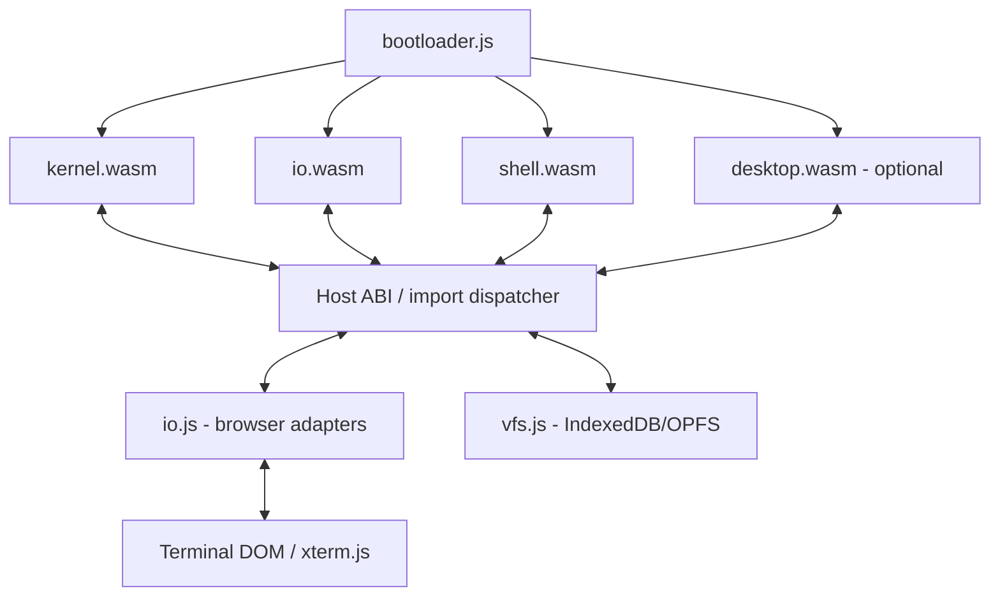

# MaiaOS Shell — implementation blueprint

**Status:** structural phase-one grammar validated with the MaiaCC JavaScript generator and collector against representative fixtures. It is not POSIX-conformant and is not a working shell. The reference for comparison is POSIX.1-2017, Shell Grammar, sections 2.10.1 and 2.10.2.

## Architecture



The browser is the real host. Separate WASM modules do not magically share memory or link symbols. Implement a **versioned C ABI** through JS import/export dispatch and copy buffers across separate linear memories. A single shared-memory design is a separate, advanced option requiring compatible toolchains and browser isolation.

## REx parser generation

Reference: https://github.com/GuntherRademacher/rex-parser-generator and https://www.bottlecaps.de/rex/ . REx accepts W3C-style EBNF and supports C++ generation. The supplied grammar uses `::=`, `*`, `+`, `?`, character classes, `<?TOKENS?>`, and `/* ws: definition */`.

1. Open REx or install its CLI from the official project.
2. Load `maia-shell.ebnf`.
3. Select C++ output, tree support, and a parsing algorithm compatible with the grammar; inspect diagnostics.
4. Fix conflicts and lexer token priorities, regenerate, and run parser fixtures.
5. Commit generated sources under `generated/` and record REx version and exact invocation in `docs/generation-log.md`.
6. Compile generated C++ sources with the Emscripten SDK into `shell.wasm`, together with scanner, AST builder, expansion engine, and executor.

**Important:** the grammar is only a structural subset. It covers basic simple commands, assignments, file redirections, pipelines, AND/OR lists, subshells, brace groups, `if`, `while`, `until`, and `for`. It does not yet cover `case`, function definitions, here-document bodies, or POSIX word expansion. Its quoted-word lexer is deliberately limited. It also treats reserved words globally and recognizes digit-only tokens as `IO_NUMBER` without checking that they are adjacent to `<` or `>`; POSIX 2.10 requires parser-context classification for reserved words, `NAME`, `ASSIGNMENT_WORD`, and `IO_NUMBER`. These cases require a stateful/context-aware scanner or parser integration, not a change to the grammar productions alone. No POSIX-conformance claim should be made until those rules are implemented and differentially tested.

The current grammar was generated to a temporary JavaScript parser with MaiaCC and exercised through `ParseTreeCollector`. Valid fixtures covered simple commands, assignments, redirections, pipelines, AND/OR lists, comments, quoting, compound groups and loops. Invalid fixtures covered repeated separators and adjacent pipeline operators. This verifies generation and the declared subset only; it does not replace the POSIX lexical-convention rules.

## Parser test runner

The runner regenerates the JS parser into the OS temporary directory, parses the scenario corpus, checks expected production rules, and compares every parse-tree terminal with the lexer's token stream and source offsets. Generated parser files are removed when the run ends.

Set `MAIACC_ROOT` to a MaiaCC checkout, then run the suite:

```sh
MAIACC_ROOT=/path/to/maiacc npm run test:shell-grammar
```

Print every accepted fixture tree, or inspect a script/command directly:

```sh
MAIACC_ROOT=/path/to/maiacc npm run test:shell-grammar -- --print-trees
MAIACC_ROOT=/path/to/maiacc npm run test:shell-grammar -- --file apps/shell/tests/fixtures/demo.sh
MAIACC_ROOT=/path/to/maiacc npm run test:shell-grammar -- --input 'echo hello | wc -l'
```

The default run reports known POSIX lexical gaps separately. Add `--strict-posix` to make those gaps fail the command while contextual tokenization remains unfinished.

## Parsing semantics

Use stages: browser input -> incremental lexer -> REx parser -> AST -> expansions -> executor -> kernel ABI. Lexer must preserve newlines, comments, quote contexts, heredoc delimiters/bodies, reserved words in command position, assignment words, and IO_NUMBER adjacency. Expansions: tilde, parameter, command, arithmetic, field splitting, pathname globbing, quote removal (correct order and contexts). Redirections are processed left to right. `cd`, `export`, `unset`, `set`, `exit`, `read`, `shift`, `trap` and `umask` must run in the current shell environment when appropriate.

## Terminal and asynchronous stdin

Use xterm.js or a minimal DOM terminal for display. Keyboard events produce UTF-8 bytes and control events (Enter, Backspace, Ctrl-C, Ctrl-D). `io.js` queues input per TTY; `io.wasm` manages canonical editing, echo, line discipline, and fd 0/1/2. **Do not synchronously block the browser main thread.** Prefer asyncify/JSPI where supported, or an explicit coroutine/state-machine API (`shell_start`, `shell_feed`, `shell_poll`, `shell_resume`) with `EAGAIN`/pending results. A dedicated Worker can run WASM and exchange messages with the UI; blocking waits are only appropriate in a Worker with supported shared-memory primitives. `read` builtin consumes the same fd 0 stream as external programs.

## Host ABI proposal

`maia_open(path, flags, mode) -> fd`; `maia_close(fd)`; `maia_read(fd, ptr, len) -> ssize_t/pending`; `maia_write(fd, ptr, len)`; `maia_seek(fd, off, whence)`; `maia_stat(path, out)`; `maia_readdir(fd, out)`; `maia_mkdir(path, mode)`; `maia_unlink(path)`; `maia_rename(old,new)`; `maia_chdir(path)`; `maia_getcwd(out,len)`; `maia_clock_gettime(...)`; `maia_spawn(...)`; `maia_wait(...)`; `maia_pipe(...)`; `maia_dup2(...)`; `maia_tty_ioctl(...)`.

Use integer handles, fixed-width types, errno conventions, UTF-8 paths, ABI version checks, and per-process descriptor tables. Pointers always refer to the *calling module's* memory and require marshaling by the host. Define pending/async semantics explicitly; a plain synchronous C ABI cannot transparently await browser storage operations.

## Virtual filesystem

Mount `/` (root), `/bin` (commands), `/home/guest`, `/tmp`, `/dev` (tty/null/zero), `/proc` (synthetic, optional). `vfs.js` maintains inodes, directories, metadata, symlinks (phase 2), file handles and mounts. Start with memory backend, add OPFS/IndexedDB persistence and transactional error handling. Never treat browser storage as a real host POSIX filesystem. `cwd` is per-process; `cd` does not change the browser URL.

## Command inventory

**Shell builtins, phase 1:** `:`, `.`, `alias`, `bg`, `break`, `cd`, `command`, `continue`, `echo`, `eval`, `exec`, `exit`, `export`, `false`, `fg`, `getopts`, `hash`, `jobs`, `kill`, `pwd`, `read`, `readonly`, `return`, `set`, `shift`, `test`, `[`, `times`, `trap`, `true`, `type`, `ulimit`, `umask`, `unalias`, `unset`, `wait`.

**Core utilities, phase 1:** `basename`, `cat`, `clear`, `cmp`, `cp`, `cut`, `date`, `dirname`, `env`, `expr`, `find`, `grep`, `head`, `id`, `ln`, `ls`, `mkdir`, `mktemp`, `mv`, `printf`, `rm`, `rmdir`, `sed`, `seq`, `sleep`, `sort`, `stat`, `tail`, `tee`, `touch`, `tr`, `uname`, `uniq`, `wc`, `which`, `xargs`, `yes`.

**Phase 2 (depending on kernel support):** `awk`, `chmod`, `chown`, `dd`, `df`, `du`, `file`, `gzip`, `gunzip`, `less`, `more`, `od`, `paste`, `ps`, `tar`, `time`, `timeout`, `top`, `tty`, `vi`.

**Not promised:** real OS processes, native fork/exec, signals, networking, users/groups, device permissions or complete BusyBox behavior. These need explicit emulation or capability mapping. A command name in the inventory is a target, not an implemented feature.

## Implementation roadmap

1. Boot: loader instantiates modules and checks ABI versions; terminal prints `MaiaOS>`.
2. TTY: editable input line, stdout/stderr, Ctrl-C/Ctrl-D, multiline continuation.
3. VFS: memory filesystem, fd table, `/home/guest`, basic read/write/list operations.
4. Parser: validate grammar and generated C++; AST for words, simple commands, pipelines, redirections.
5. Executor: `echo`, `pwd`, `cd`, `ls`, `cat`, `mkdir`, `touch`, `rm`, `exit`.
6. Jobs: pipe buffers with backpressure; cooperative tasks and `wait`; no false claims of POSIX fork.
7. Shell language: variables, quoting, expansion, if/for/while/functions, substitutions, heredocs.
8. Persistence and GUI: OPFS/IndexedDB and optional `desktop.wasm` terminal window.
9. POSIX conformance: build fixtures from the Open Group shell specification and differential-test against `dash`/BusyBox `ash` where semantics are comparable.

## Acceptance criteria

`echo hello`; `pwd`; `mkdir demo; cd demo; echo hi > a.txt; cat a.txt`; `echo abc | tr a-z A-Z`; `false || echo recovered`; `printf 'a\nb\n' | wc -l`; `read name` (type at terminal); multiline input; Ctrl-C; EOF; reload and recover persisted file. Verify exit codes, stderr, ordering, no UI freeze, no dropped bytes, no parser hang on malformed input, and ABI mismatch detection.

## References

- POSIX.1-2017 Shell Grammar, lexical conventions and grammar rules: https://pubs.opengroup.org/onlinepubs/9699919799/utilities/V3_chap02.html#tag_18_10
- POSIX shell grammar source for study: https://gist.github.com/Chubek/42ec6e7b65d17888eeaaaad50738bff9
- REx: https://github.com/GuntherRademacher/rex-parser-generator
- POSIX Shell Command Language: https://pubs.opengroup.org/onlinepubs/9799919799/utilities/V3_chap02.html
- BusyBox: https://busybox.net/
