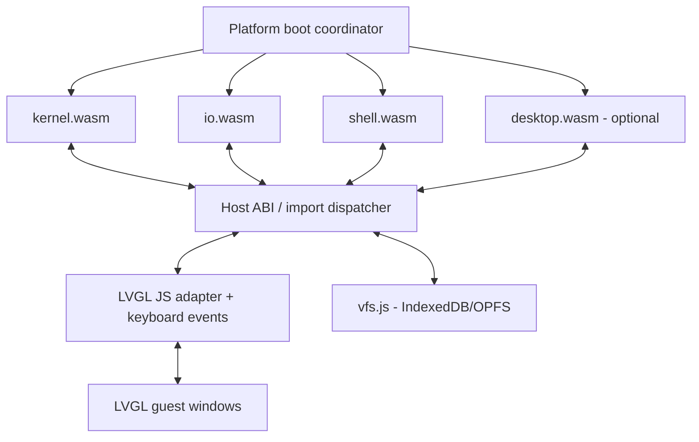

# MaiaOS Shell — implementation blueprint

**Status:** bounded MVP with MaiaCC-generated C++98 lexing/parsing integrated in the WASM guest. The app guest supports `help`, `echo`, `pwd`, `cat /system/welcome.txt`, `clear`, and `exit`; it is not POSIX-conformant. The reference for comparison is POSIX.1-2017, Shell Grammar, sections 2.10.1 and 2.10.2.

## Architecture



The browser is the real host. Separate WASM modules do not magically share memory or link symbols. Implement a **versioned C ABI** through JS import/export dispatch and copy buffers across separate linear memories. A single shared-memory design is a separate, advanced option requiring compatible toolchains and browser isolation.

The diagram is the target module decomposition. The browser coordinator is `platform/desktop-web/main.js`; there is no separate `bootloader.js`. The kernel, Calculator, Clock, and Shell guests have buildable WASM artifacts. `io.wasm` and `desktop.wasm` remain future work. The Shell guest is C++98 compiled by MaiaCpp AST-strict -> C89 -> MaiaC -> WASM, then creates its terminal window and labels through LVGL imports. The browser host forwards keyboard events into the guest event queue; it does not render a separate shell DOM panel.

## MaiaCC parser generation

The shell grammar source is `apps/shell/maia-shell.ebnf`. Parser generation is owned by the in-repository MaiaCC toolchain (`maiacpp/maiacc`); REx is an internal stage of MaiaCC's EBNF pipeline, not a separate compiler dependency for MaiaOS. The build generates a C++98 lexer/parser header and links it into `shell.wasm` with the repository-local MaiaRegex instruction runtime and MaiaC libc. JavaScript parser generation supplies independent test oracles.

1. Edit only `apps/shell/maia-shell.ebnf` for grammar changes; never hand-edit generated parsers.
2. Use the MaiaCC parser generator from the recursive submodule and regenerate the target parser from EBNF.
3. Run the shell grammar fixtures and validate lexer/parser token and source-offset agreement.
4. Treat the generated JavaScript parser as a grammar-test oracle; the runtime guest calls the generated `maiaCCLexerTokenize` and `maiaCC_parse` on raw input. The collector contains no replacement lexical rules.
5. Compile the runtime guest through MaiaCpp AST-strict -> C89 -> MaiaC -> WASM; do not use Emscripten for `shell.wasm`.

**Important:** the grammar is only a structural subset. It covers basic simple commands, assignments, file redirections, pipelines, AND/OR lists, subshells, brace groups, `if`, `while`, `until`, and `for`. It does not yet cover `case`, function definitions, here-document bodies, or POSIX word expansion. Its quoted-word lexer is deliberately limited. It also treats reserved words globally and recognizes digit-only tokens as `IO_NUMBER` without checking that they are adjacent to `<` or `>`; POSIX 2.10 requires parser-context classification for reserved words, `NAME`, `ASSIGNMENT_WORD`, and `IO_NUMBER`. These cases require a stateful/context-aware scanner or parser integration, not a change to the grammar productions alone. No POSIX-conformance claim should be made until those rules are implemented and differentially tested.

The current grammar is exercised through `ParseTreeCollector` fixtures. Valid fixtures cover simple commands, assignments, redirections, pipelines, AND/OR lists, comments, quoting, compound groups and loops. Invalid fixtures cover repeated separators and adjacent pipeline operators. This verifies generation and the declared subset only; it does not replace the POSIX lexical-convention rules.

The test runner reads this exact `maia-shell.ebnf` file and regenerates a temporary JavaScript parser on every run. This validates the declared grammar subset only. The runtime guest embeds the generated C++98 lexer/parser. Its bounded tree adapter and simple-command dispatcher are separate from generated syntax. MaiaCC grammar coverage is not a claim that compound commands, assignments or redirections execute.

## Current MVP behavior

The Shell is launched as a normal app guest from the browser app catalog. The browser host instantiates guests, schedules their step exports, enforces manifest capabilities, provides the VFS and LVGL callbacks, and forwards keyboard events to the focused shell guest. The prompt, output, editable line, and caret are LVGL labels created by the guest. There is no HTML input or Send button for shell commands. A separate `io.wasm` is not required for this slice.

The guest uses these imported system calls:

| Import | MVP behavior |
|---|---|
| `maia.gfx.window_create(title_ptr, title_len)` | Create the shell's LVGL window. |
| `maia.gfx.label_create(parent, text_ptr, text_len)` | Create output and command-line labels inside that window. |
| `maia.gfx.label_set_text(label, text_ptr, text_len)` | Draw guest-generated prompt, output, and caret text. |
| `maia.events.poll(packet_ptr, capacity)` | Read versioned events. The host sends keyboard packets with printable ASCII in `data0` and the key identifier in `data1`: Enter, arrows, Home/End, Backspace, Delete, and Up/Down. |
| `maia.vfs.open/read/close` | Read `/system/welcome.txt` for `cat`. |
| `maia.process.exit(status)` | Exit the shell guest cleanly. |

The host forwards keys only while the LVGL screen has focus. The guest owns the editable line, cursor, and one-line history, and executes on Enter; it never blocks the browser event loop. The manifest's `tty.input` capability enables keyboard routing. There are no `maia.tty` imports or shell DOM controls. `maia.log.write` remains diagnostics, not user-facing shell output.

Reuse the current VFS API for reading existing files. The current ABI does **not** provide directory enumeration, `mkdir`, `unlink`, `chdir`, pipes, process spawn, or terminal descriptors. The MVP command set is `help`, `echo`, shell-local `pwd`, `cat /system/welcome.txt`, `clear`, and `exit`. Add `ls`, writable files, `cd`, redirection, and pipelines only with their required VFS/process contracts and tests. The commands in the future inventory below are not implemented by listing them here.

The current shell uses the app lifecycle (`maia_app_start` plus `maiaos_step`), `apps/shell/manifest.json`, LVGL and event imports, and the MaiaCpp AST-strict -> C89 -> MaiaC -> WASM pipeline. The host smoke and browser test verify the five commands, key editing, LVGL output, VFS access, and exit.

## Status and next steps

| Area | Status |
|---|---|
| MaiaCC grammar | Structural subset; generated C++98 lexer/parser embedded in the runtime guest and checked against the JS oracle. |
| Browser app catalog and LVGL | Implemented; the guest draws its own window, prompt, output, editable line, and caret. |
| Keyboard event syscalls | Implemented; printable keys, Enter, arrows, Home/End, Backspace, Delete, and one-line Up/Down history are handled by the C guest. |
| Minimal command executor | Implemented and tested: `help`, `echo`, shell-local `pwd`, `cat /system/welcome.txt`, `clear`, and `exit`. |
| Browser host smoke | Existing MVP had interactive verification. This integration is tested through Node and the real LVGL-WASM callbacks; browser interaction was not rerun because the integrated browser is unavailable. |
| Directory and mutable filesystem commands | Not implemented. The VFS needs directory enumeration and working-directory semantics before `ls` or `cd`; writes need their own behavior and tests. |
| Pipelines, redirection, expansions, jobs, and POSIX conformance | Future work; not required for this MVP. |

The current vertical slice is **kernel + LVGL host callbacks + shell app**. A separate `io.wasm`, HTML terminal panel, Send button, and the Espressif bootloader are not part of this MVP.

## Integrated lexer/parser validation

```sh
npm run build:shell
npm run build:shell -- --check-c89
npm run test:shell-parser
npm run test:shell-host
npm run test:shell-lvgl
npm test
```

The build uses only `maiacpp/maiacc`, `maiacpp/maiaregex` and `maiacpp/maiac`
from this repository. `generated/maia-shell-parser.hpp` and its copied Regex
header are reproducible build outputs. C++98 is lowered in AST-strict mode;
MaiaC/MaiaWASM produce the guest. The optional `--check-c89` validation uses
Clang's strict C89 checker with the wasm32 pointer ABI. Normal guest builds
require only the Maia toolchain and Node; Clang never generates the guest.

The raw-input suite regenerates both backends in temporary directories and
compares 52 cases: lexing success/failure, token types/values/UTF-16 offsets and
complete accepted trees. Native C++ receives raw input, not JS-produced tokens.
It includes Unicode quotes, malformed quotes/escapes and collector exhaustion.
The previous pre-tokenized parity runner below remains a separate check.

Guest tests deliver keyboard events through `maia.events`, verify exact LVGL
output, all six commands, quotes/comments, syntax errors, unsupported compound
execution and capacity limits. One thousand repeated parses must restore their
frames and reuse allocations without growing linear memory. `--lvgl` uses the
actual platform LVGL module and requires valid RGB565 flushes; callback-only
checks are also retained. Browser UI interaction is a separate unrun check.

Limits remain explicit: 255 editable ASCII bytes, 32 lexer tokens including EOF,
12 command words, 95 decoded bytes per word, 1024 tree nodes and a 4096-byte
terminal buffer. These are bounded MVP resources, not a full POSIX shell.
Errors distinguish malformed syntax, unimplemented execution and capacity.
The 263-byte input-display buffer includes the six-byte prompt, 255 editable
bytes, the cursor and terminating NUL. Prompt, input and caret share one LVGL
label; submitted prompts/commands move into the separate history label.

C++ libc/Regex allocations run in the guest. Host `env` bindings implement only
memory size/grow and forward allocator bridges to guest malloc/free when linked;
MaiaOS system calls and capability names remain unchanged. The existing LVGL configuration is preserved. The real-LVGL test advances
its timer/render loop after guest events, matching the platform scheduler;
starving that loop in a synthetic stress test exhausts temporary GUI resources.

The grammar itself is unchanged by this integration. Known lexical gaps include
reserved-word context and descriptor adjacency. Additional structural diagnoses
include acceptance of `if true then echo yes; fi` and `for x in a do echo hi; done`
without required separators; these are not POSIX conformance successes. The
executor rejects such compound syntax as unsupported. Shell expansion and
multiline editing/execution remain future work.

## Parser test runner

The current manifest loads `shell.wasm`. The retained `shell.js` is a legacy
wrapper artifact, not the current guest entry or the generated JS parser oracle.
`maia-shell.js`, `maia-shell.cpp` and `maia-shell.xml` are comparison artifacts
regenerated by `node apps/shell/rtest.js --cpp`; the runtime build separately
generates `generated/maia-shell-parser.hpp` from the same EBNF.

For deterministic differential testing of the generated lexer/parser on raw
UTF-8 inputs, run `npm run test:shell-equivalence`. It regenerates both backends
from this EBNF, evaluates JavaScript, compiles the C++98 adapter natively, then
compiles a test-only C++98 adapter through MaiaCpp -> C89 -> MaiaC/MaiaWASM.
The same raw bytes reach each generated lexer. Comparisons include complete
token streams and UTF-16 offsets, lexical failure positions and partial token
streams, syntax acceptance, and complete accepted tree hierarchy/terminal values.

The deterministic corpus includes existing fixtures, ASCII/control characters,
Unicode boundaries, fragment pairs, seeded mutations, structured commands,
long words, incomplete inputs and nesting through 128 subshells. Seed:
`0x4d414941`. Test-only WASM buffers (4096 input bytes, 2048 tokens, 8192 nodes)
allow comparison beyond the interactive shell's 255-byte/32-token budget;
production limits are unchanged. Matching, parsing, Regex and allocation execute
inside the WASM test module. Its host imports supply existing libc memory
primitives only; graphics callbacks fail if unexpectedly invoked. This test
does not claim GUI, execution, device/VM or full POSIX conformance.

`MAIA_SHELL_KEEP_BUILD=1 npm run test:shell-equivalence` retains generated
sources, native binary, WASM and `report.json` in the printed temporary directory.
Failure artifacts are always retained. A finite matching corpus is evidence of
equivalence on those inputs, not a proof for every input or resource limit.

Parsers in this project must be generated automatically from EBNF exclusively with MaiaCC/tREx. Do not implement syntax rules in handwritten replacement parsers or edit generated files manually.

The isolated cross-language suite uses the local `maia-shell.js` and `parse-tree-collector.js`. Run from the repository root:

```sh
node apps/shell/rtest.js
node apps/shell/rtest.js --cpp
node apps/shell/rtest.js --cpp --print-trees
```

Each run regenerates `maia-shell.js` and `maia-shell.xml` from the EBNF with the in-repository MaiaCC/tREx. It checks 44 valid/invalid cases, including physical scripts in `tests/fixtures`, expected productions, token leaves, and source offsets. `--print-trees` displays collected JavaScript trees.

Only after all JavaScript checks pass, `--cpp` generates `maia-shell.cpp` using `--language cpp98`, compiles `test.cpp` with `clang++ -std=c++98`, and tests the same token streams with `maia-shell-parse-tree-collector.hpp`. Every accepted C++ tree must match the JavaScript tree in full (hierarchy, rules, terminal types, and values). Temporary binaries are removed after testing. This verifies native C++ parser/collector parity, not a generated C++ lexer, the WASM build, or execution of these scripts by the shell. The C++ driver receives tokens from the MaiaCC-generated JavaScript lexer; it does not parse shell syntax itself. Existing POSIX lexical gaps remain and are reported by the separate suite below.

The runner regenerates the JS parser into the OS temporary directory, parses the scenario corpus, checks expected production rules, and compares every parse-tree terminal with the lexer's token stream and source offsets. Generated parser files are removed when the run ends.

Point `MAIACC_ROOT` at the in-repository MaiaCC submodule, then run the suite:

```sh
MAIACC_ROOT="$PWD/maiacpp/maiacc" npm run test:shell-grammar
```

Print every accepted fixture tree, or inspect a script/command directly:

```sh
MAIACC_ROOT="$PWD/maiacpp/maiacc" npm run test:shell-grammar -- --print-trees
MAIACC_ROOT="$PWD/maiacpp/maiacc" npm run test:shell-grammar -- --file apps/shell/tests/fixtures/demo.sh
MAIACC_ROOT="$PWD/maiacpp/maiacc" npm run test:shell-grammar -- --input 'echo hello | wc -l'
```

The default run reports known POSIX lexical gaps separately. Add `--strict-posix` to make those gaps fail the command while contextual tokenization remains unfinished.

## Parsing semantics

The current path is: keyboard -> host event packet -> C++98 line editor -> MaiaCC-generated lexer/parser -> bounded parse-tree validation and word evaluation -> simple-command dispatch -> LVGL/VFS/process imports. The MVP handles command words with basic quotes and escapes. Defer heredocs, POSIX-context-sensitive reserved words, full assignment semantics, expansions, shell functions, `trap`, and job control. `cd`, `export`, `unset`, `set`, `read`, `shift`, and `umask` require persistent shell state and are not part of this command slice.

## Terminal and asynchronous stdin roadmap

The browser host translates keydown events into `maia.events` packets only while the LVGL display canvas has focus. The C guest edits and renders the line inside its LVGL window; Enter sends it to the command executor. This avoids DOM terminal controls, asyncify/JSPI, a Worker, and `io.wasm`.

Later, `io.wasm` may own canonical editing, echo, line discipline, and fd 0/1/2. If introduced, it needs an explicit asynchronous ABI and a process/IPC design. **Do not synchronously block the browser main thread.** A coroutine/state-machine API or Worker may be evaluated after the simple host TTY is usable.

## Long-term host ABI proposal

`maia_open(path, flags, mode) -> fd`; `maia_close(fd)`; `maia_read(fd, ptr, len) -> ssize_t/pending`; `maia_write(fd, ptr, len)`; `maia_seek(fd, off, whence)`; `maia_stat(path, out)`; `maia_readdir(fd, out)`; `maia_mkdir(path, mode)`; `maia_unlink(path)`; `maia_rename(old,new)`; `maia_chdir(path)`; `maia_getcwd(out,len)`; `maia_clock_gettime(...)`; `maia_spawn(...)`; `maia_wait(...)`; `maia_pipe(...)`; `maia_dup2(...)`; `maia_tty_ioctl(...)`.

This broad POSIX-like proposal is **not** the ABI to implement for the MVP. It overlaps the existing `maia.vfs` imports and includes unsupported process, pipe, directory, and terminal calls. Reuse the existing VFS signatures and the LVGL/event imports listed above. Revisit this broader interface only when there is a real consumer for the additional operations.

## Virtual filesystem limits

The shell currently reads the seeded `/system/welcome.txt` through the existing VFS API. The ABI does not expose directory enumeration, `mkdir`, `unlink`, or `chdir`, so `ls`, `cd`, and mutable filesystem workflows are outside the MVP. Browser storage is not a host POSIX filesystem; future `cwd` must remain per-process and must not change the browser URL.

## Future command inventory

The grammar test validates parsing only. The implemented MVP commands are listed above; the utilities and builtins below are targets, not implemented features.

**Future shell builtins:** `:`, `.`, `alias`, `bg`, `break`, `cd`, `command`, `continue`, `eval`, `exec`, `export`, `false`, `fg`, `getopts`, `hash`, `jobs`, `kill`, `read`, `readonly`, `return`, `set`, `shift`, `test`, `[`, `times`, `trap`, `true`, `type`, `ulimit`, `umask`, `unalias`, `unset`, `wait`.

**Core utilities, phase 1:** `basename`, `clear`, `cmp`, `cp`, `cut`, `date`, `dirname`, `env`, `expr`, `find`, `grep`, `head`, `id`, `ln`, `ls`, `mkdir`, `mktemp`, `mv`, `printf`, `rm`, `rmdir`, `sed`, `seq`, `sleep`, `sort`, `stat`, `tail`, `tee`, `touch`, `tr`, `uname`, `uniq`, `wc`, `which`, `xargs`, `yes`.

**Phase 2 (depending on kernel support):** `awk`, `chmod`, `chown`, `dd`, `df`, `du`, `file`, `gzip`, `gunzip`, `less`, `more`, `od`, `paste`, `ps`, `tar`, `time`, `timeout`, `top`, `tty`, `vi`.

**Not promised:** real OS processes, native fork/exec, signals, networking, users/groups, device permissions or complete BusyBox behavior. These need explicit emulation or capability mapping. A command name in the inventory is a target, not an implemented feature.

## Roadmap

1. **Done:** browser app launch, LVGL window, event-driven line editing with cursor/history, simple-command execution, and the six-command shell guest.
2. **Next:** define directory enumeration and per-app working-directory behavior in the VFS; then add `ls` and `cd` with tests.
3. **Later:** writable files, redirection, pipelines, expansion, and process/job semantics, each behind an explicit host contract.
4. **Long term:** persistence improvements and differential tests for the POSIX shell features MaiaOS chooses to support.

## Next acceptance criteria

Add VFS directory enumeration and a shell-local working directory, then verify `ls` and `cd` without changing the browser URL. Keep the existing smoke checks for command output, stderr, process exit, and nonblocking input; add pipeline and redirection criteria only after those host contracts exist.

## References

- POSIX.1-2017 Shell Grammar, lexical conventions and grammar rules: https://pubs.opengroup.org/onlinepubs/9699919799/utilities/V3_chap02.html#tag_18_10
- POSIX shell grammar source for study: https://gist.github.com/Chubek/42ec6e7b65d17888eeaaaad50738bff9
- REx: https://github.com/GuntherRademacher/rex-parser-generator
- POSIX Shell Command Language: https://pubs.opengroup.org/onlinepubs/9799919799/utilities/V3_chap02.html
- BusyBox: https://busybox.net/
