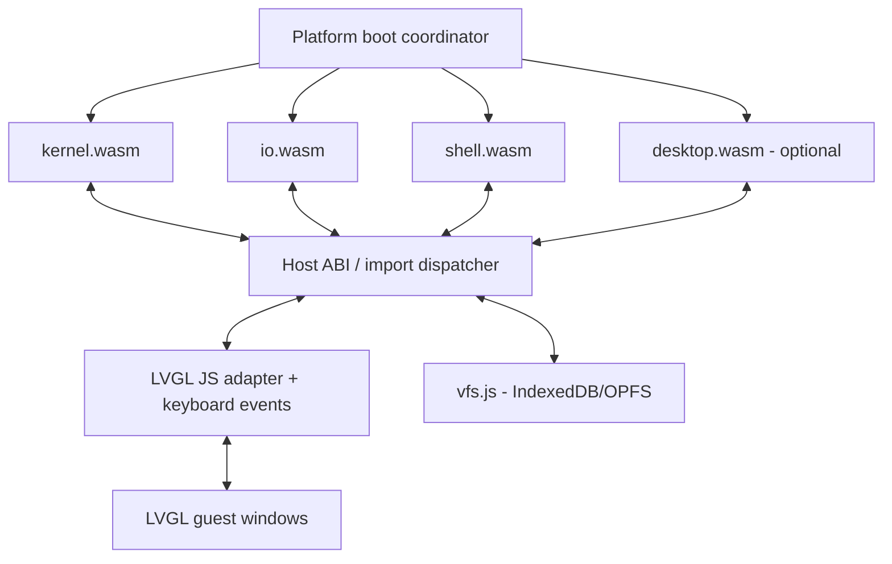

# MaiaOS Shell — implementation blueprint

**Status:** bounded MVP with MaiaCC-generated C++98 lexing/parsing integrated in the WASM guest. The app guest supports `help`, `echo`, `pwd`, `ls`, `cd`, `cat <file> [file ...]`, `clear`, and `exit`; it is not POSIX-conformant. The reference for comparison is POSIX.1-2017, Shell Grammar, sections 2.10.1 and 2.10.2.

## Architecture



The browser is the real host. Separate WASM modules do not magically share memory or link symbols. Implement a **versioned C ABI** through JS import/export dispatch and copy buffers across separate linear memories. A single shared-memory design is a separate, advanced option requiring compatible toolchains and browser isolation.

The diagram is the target module decomposition. The browser coordinator is `platform/desktop-web/main.js`; there is no separate `bootloader.js`. The kernel, Calculator, Clock, and Shell guests have buildable WASM artifacts. `io.wasm` and `desktop.wasm` remain future work. The Shell guest is C++98 compiled by MaiaCpp AST-strict -> C89 -> MaiaC -> WASM, then creates its terminal window and labels through LVGL imports. The browser host forwards keyboard events into the guest event queue; it does not render a separate shell DOM panel.

## MaiaCC parser generation

The shell grammar source is `apps/shell/maia-shell.ebnf`. Parser generation is owned by the in-repository MaiaCC toolchain (`maiacpp/maiacc`); REx is an internal stage of MaiaCC's EBNF pipeline, not a separate compiler dependency for MaiaOS. The build generates a C++98 lexer/parser header and links it into `shell.wasm` with the repository-local MaiaRegex instruction runtime and MaiaC libc. JavaScript parser generation supplies independent test oracles.

1. Edit only `apps/shell/maia-shell.ebnf` for grammar changes; never hand-edit generated parsers.
2. Use the MaiaCC parser generator from the recursive submodule and regenerate the target parser from EBNF.
3. Run the shell grammar fixtures and validate lexer/parser token and source-offset agreement.
4. Treat the generated JavaScript parser as a grammar-test oracle; the runtime guest calls the generated `maiaCCLexerTokenize` and `maiaCC_parse` on raw input. The collector contains no replacement lexical rules.
5. Compile the runtime guest through MaiaCpp AST-strict -> C89 -> MaiaC -> WASM; do not use Emscripten for `shell.wasm`.

**Important:** the grammar is only a structural subset. It covers basic simple commands, assignments, file redirections, pipelines, AND/OR lists, subshells, brace groups, `if`, `while`, `until`, and `for`. It does not yet cover `case`, function definitions, here-document bodies, or the full POSIX word-expansion sequence (bounded filename expansion is implemented separately below). Its quoted-word lexer is deliberately limited. It also treats reserved words globally and recognizes digit-only tokens as `IO_NUMBER` without checking that they are adjacent to `<` or `>`; POSIX 2.10 requires parser-context classification for reserved words, `NAME`, `ASSIGNMENT_WORD`, and `IO_NUMBER`. These cases require a stateful/context-aware scanner or parser integration, not a change to the grammar productions alone. No POSIX-conformance claim should be made until those rules are implemented and differentially tested.

The current grammar is exercised through `ParseTreeCollector` fixtures. Valid fixtures cover simple commands, assignments, redirections, pipelines, AND/OR lists, comments, quoting, compound groups and loops. Invalid fixtures cover repeated separators and adjacent pipeline operators. This verifies generation and the declared subset only; it does not replace the POSIX lexical-convention rules.

The test runner reads this exact `maia-shell.ebnf` file and regenerates a temporary JavaScript parser on every run. This validates the declared grammar subset only. The runtime guest embeds the generated C++98 lexer/parser. Its bounded tree adapter and simple-command dispatcher are separate from generated syntax. MaiaCC grammar coverage is not a claim that compound commands or assignments execute. Stdout redirection is the separately tested extension described below.

## Current MVP behavior

The browser launches a real `io.wasm` service alongside `shell.wasm` while
`kernel.wasm` keeps stepping. Every guest has a separate linear memory. The I/O
service owns its LVGL window, terminal output, keyboard editing, caret and
one-line history. The shell generates prompt bytes, parses with the generated
C++98 lexer/parser and executes commands/VFS operations.

| Guest | Imports / responsibility |
|---|---|
| I/O | `maia.gfx.window_create/label_create/label_set_text`, `maia.events.poll`, `maia.stream.read/write/close`, `maia.process.exit` |
| Shell | `maia.stream.read/write/close`, `maia.vfs.open/read/close/opendir/readdir`, `maia.process.exit`, toolchain memory/allocator support |

The shell reads stdin on handle0 and writes stdout/stderr on1/2. The I/O service
writes canonical stdin on3 and reads terminal output on4/5. The terminal binds
stdout/stderr to aliases of the same ordered sink. Partial transfers, bounded
buffers, WOULD_BLOCK, EOF and peer closure are specified in
[ABI v0](../../docs/specifications/abi-v0.md). Each guest yields from its step
function; no browser main-thread blocking or JavaScript terminal is involved.
Only I/O requests `tty.input`; the host routes keys while the LVGL canvas has
focus. Prompt, edited input and caret share a single live-line LVGL label.

The command set is `help`, `echo`, `pwd`, `ls [path ...]`, `cd [path]`,
`cat <file> [file ...]`, `clear`, `exit`. `clear` emits the supported terminal clear/home escape sequence.
The additive `maia.vfs.opendir/readdir` imports supply bounded directory snapshots.
MaiaGlob performs bounded `*`, `?` and bracket-class expansion in the guest,
preserving quoted/escaped bytes. Each source word's matches are sorted by UTF-8
bytes; unmatched words remain literal. Expansion completes before command
dispatch, with errors instead of partial execution when a limit is reached.
`ls` accepts multiple file/directory operands and continues after an operand
error; directory headings appear with multiple operands. Options remain unsupported.
`cat` reads the final expanded operands sequentially, with one file handle at a time.
The shell owns its cwd; no host-global chdir is performed. Mutable directory
operations, general spawning and descriptor transfer remain future work.
The shell retains `maia_app_start`/`maiaos_step`; I/O uses
`maia_io_start`/`maiaos_step`. Both compile through MaiaCpp AST-strict -> C89 ->
MaiaC/MaiaWASM; Emscripten builds only the separate platform LVGL module.

## Status and next steps

| Area | Status |
|---|---|
| MaiaCC grammar | Structural subset; generated C++98 lexer/parser embedded in the runtime guest and checked against the JS oracle. |
| Browser app catalog and LVGL | Implemented; I/O draws its window, output, editable line and caret using shell prompt bytes. |
| Keyboard event syscalls | Implemented; printable keys, Enter, arrows, Home/End, Backspace, Delete, and one-line Up/Down history are handled by the C++98 I/O guest. |
| Minimal command executor | Implemented and tested: `help`, `echo`, `pwd`, `ls`, `cd`, `cat <file> [file ...]`, `clear`, `exit`. |
| Browser host smoke | Existing MVP had interactive verification. This integration is tested through Node and the real LVGL-WASM callbacks; interactive browser verification was not rerun for this change. |
| Directory navigation | Implemented: bounded `ls [path ...]`, `cd [path]`, real per-instance `pwd`; own-home isolation and escaped control bytes. |
| Mutable filesystem commands | Not implemented; mkdir/unlink remain future work; stdout file redirection follows the approved bounded VFS contract. |
| Filename expansion | MaiaGlob guest compiler/walker, quote masks, per-word byte sorting and atomic argv limits; see the consumer plan and its current validation status. |
| Pipelines | Initial cat-only groups use the kernel process table, separate WASM workers and bounded pipes; see the implemented contract below. |
| Input/descriptor redirection, other expansions, jobs and POSIX conformance | Future work. |

The current reference vertical slice is **kernel + I/O service + shell app + real LVGL callbacks**, with bounded copied-byte streams. Device firmware/MaiaWASMVM integration is still pending.

## Integrated lexer/parser validation

```sh
npm run build:io -- --check-c89
npm run build:shell
npm run build:shell -- --check-c89
npm run test:shell-parser
npm run test:shell-host
npm run test:shell-lvgl
npm run test:io-streams
npm run test:shell-boot
npm run test:shell-directories
npm run test:shell-files
npm run test:shell-glob
npm test
```

The build uses only `maiacpp/maiacc`, `maiacpp/maiaregex` and `maiacpp/maiac`
from this repository. `generated/maia-shell-parser.hpp` and its copied Regex
header are reproducible build outputs. C++98 is lowered in AST-strict mode;
MaiaC/MaiaWASM produce the guest. The optional `--check-c89` validation uses
Clang's strict C89 checker with the wasm32 pointer ABI. Normal guest builds
require only the Maia toolchain and Node; Clang never generates the guest.

The raw-input suite regenerates both backends in temporary directories and
compares 52 cases: lexing success/failure, token types/values/UTF-16 offsets and
complete accepted trees. Native C++ receives raw input, not JS-produced tokens.
It includes Unicode quotes, malformed quotes/escapes and collector exhaustion.
The previous pre-tokenized parity runner below remains a separate check.

Guest tests deliver keyboard events to I/O through `maia.events`, transport canonical
bytes to the actual shell and verify exact LVGL
output, all eight commands, quotes/comments, syntax errors, unsupported compound
execution and capacity limits. One thousand repeated parses must restore their
frames and reuse allocations without growing linear memory. `--lvgl` uses the
actual platform LVGL module and requires valid RGB565 flushes; callback-only
checks are also retained. Browser UI interaction is a separate unrun check.

Limits remain explicit: 255 editable ASCII bytes, 32 lexer tokens including EOF,
12 command words, 95 decoded bytes per word, 1024 tree nodes and a 4096-byte
terminal buffer. These are bounded MVP resources, not a full POSIX shell.
Errors distinguish malformed syntax, unimplemented execution and capacity.
The I/O live-line display is bounded at 4095 UTF-8 bytes plus NUL, including
255 editable ASCII bytes and a caret. Output UTF-8 is decoded incrementally;
invalid/truncated sequences render U+FFFD. Prompt, input and caret share one LVGL
label; submitted commands move into the history label. The terminal supports
clear/home only, and resets history at its fixed 4096-byte budget.

C++ libc/Regex allocations run in the guest. Host `env` bindings implement only
memory size/grow and forward allocator bridges to guest malloc/free when linked;
The additive stream ABI is documented separately; existing syscall signatures remain unchanged. The existing LVGL configuration is preserved. The real-LVGL test advances
its timer/render loop after guest events, matching the platform scheduler;
starving that loop in a synthetic stress test exhausts temporary GUI resources.

The grammar itself is unchanged by this integration. Known lexical gaps include
reserved-word context and descriptor adjacency. Additional structural diagnoses
include acceptance of `if true then echo yes; fi` and `for x in a do echo hi; done`
without required separators; these are not POSIX conformance successes. The
executor rejects such compound syntax as unsupported. Shell expansion and
multiline editing/execution remain future work.

## Parser test runner

The current manifest loads `shell.wasm`. The retained `shell.js` is a legacy
wrapper artifact, not the current guest entry or the generated JS parser oracle.
`maia-shell.js`, `maia-shell.cpp` and `maia-shell.xml` are comparison artifacts
regenerated by `node apps/shell/rtest.js --cpp`; the runtime build separately
generates `generated/maia-shell-parser.hpp` from the same EBNF.

For deterministic differential testing of the generated lexer/parser on raw
UTF-8 inputs, run `npm run test:shell-equivalence`. It regenerates both backends
from this EBNF, evaluates JavaScript, compiles the C++98 adapter natively, then
compiles a test-only C++98 adapter through MaiaCpp -> C89 -> MaiaC/MaiaWASM.
The same raw bytes reach each generated lexer. Comparisons include complete
token streams and UTF-16 offsets, lexical failure positions and partial token
streams, syntax acceptance, and complete accepted tree hierarchy/terminal values.

The deterministic corpus includes existing fixtures, ASCII/control characters,
Unicode boundaries, fragment pairs, seeded mutations, structured commands,
long words, incomplete inputs and nesting through 128 subshells. Seed:
`0x4d414941`. Test-only WASM buffers (4096 input bytes, 2048 tokens, 8192 nodes)
allow comparison beyond the interactive shell's 255-byte/32-token budget;
production limits are unchanged. Matching, parsing, Regex and allocation execute
inside the WASM test module. Its host imports supply existing libc memory
primitives only; graphics callbacks fail if unexpectedly invoked. This test
does not claim GUI, execution, device/VM or full POSIX conformance.

`MAIA_SHELL_KEEP_BUILD=1 npm run test:shell-equivalence` retains generated
sources, native binary, WASM and `report.json` in the printed temporary directory.
Failure artifacts are always retained. A finite matching corpus is evidence of
equivalence on those inputs, not a proof for every input or resource limit.

Parsers in this project must be generated automatically from EBNF exclusively with MaiaCC/tREx. Do not implement syntax rules in handwritten replacement parsers or edit generated files manually.

The isolated cross-language suite uses the local `maia-shell.js` and `parse-tree-collector.js`. Run from the repository root:

```sh
node apps/shell/rtest.js
node apps/shell/rtest.js --cpp
node apps/shell/rtest.js --cpp --print-trees
```

Each run regenerates `maia-shell.js` and `maia-shell.xml` from the EBNF with the in-repository MaiaCC/tREx. It checks 44 valid/invalid cases, including physical scripts in `tests/fixtures`, expected productions, token leaves, and source offsets. `--print-trees` displays collected JavaScript trees.

Only after all JavaScript checks pass, `--cpp` generates `maia-shell.cpp` using `--language cpp98`, compiles `test.cpp` with `clang++ -std=c++98`, and tests the same token streams with `maia-shell-parse-tree-collector.hpp`. Every accepted C++ tree must match the JavaScript tree in full (hierarchy, rules, terminal types, and values). Temporary binaries are removed after testing. This verifies native C++ parser/collector parity, not a generated C++ lexer, the WASM build, or execution of these scripts by the shell. The C++ driver receives tokens from the MaiaCC-generated JavaScript lexer; it does not parse shell syntax itself. Existing POSIX lexical gaps remain and are reported by the separate suite below.

The runner regenerates the JS parser into the OS temporary directory, parses the scenario corpus, checks expected production rules, and compares every parse-tree terminal with the lexer's token stream and source offsets. Generated parser files are removed when the run ends.

Point `MAIACC_ROOT` at the in-repository MaiaCC submodule, then run the suite:

```sh
MAIACC_ROOT="$PWD/maiacpp/maiacc" npm run test:shell-grammar
```

Print every accepted fixture tree, or inspect a script/command directly:

```sh
MAIACC_ROOT="$PWD/maiacpp/maiacc" npm run test:shell-grammar -- --print-trees
MAIACC_ROOT="$PWD/maiacpp/maiacc" npm run test:shell-grammar -- --file apps/shell/tests/fixtures/demo.sh
MAIACC_ROOT="$PWD/maiacpp/maiacc" npm run test:shell-grammar -- --input 'echo hello | wc -l'
```

The default run reports known POSIX lexical gaps separately. Add `--strict-posix` to make those gaps fail the command while contextual tokenization remains unfinished.

## Parsing semantics

The current path is: keyboard -> host event packet -> I/O C++98 line editor -> stdin stream -> shell MaiaCC-generated lexer/parser -> bounded parse-tree validation and word evaluation -> simple-command dispatch -> stdout/stderr streams or VFS -> I/O LVGL rendering. The MVP handles command words with basic quotes and escapes. Defer heredocs, POSIX-context-sensitive reserved words, full assignment semantics, expansions, shell functions, `trap`, and job control. `cd` keeps cwd in its own guest memory. `export`, `unset`, `set`, `read`, `shift`, and `umask` require additional shell state and are not part of this command slice.

## Terminal and asynchronous stdin roadmap

The browser translates keydown events into `maia.events` packets only while the
LVGL canvas has focus. `io.wasm` now owns canonical editing, echo, history and
terminal rendering. `shell.wasm` consumes canonical input through the approved
bounded stream ABI. Both use state machines with bounded work per step and yield
on WOULD_BLOCK; no synchronous browser wait, Worker, asyncify or JSPI is required.
Future pipelines must preserve backpressure using this stream contract and need
separate process-spawn/descriptor-binding approval and tests.

## Long-term host ABI proposal

`maia_open(path, flags, mode) -> fd`; `maia_close(fd)`; `maia_read(fd, ptr, len) -> ssize_t/pending`; `maia_write(fd, ptr, len)`; `maia_seek(fd, off, whence)`; `maia_stat(path, out)`; `maia_readdir(fd, out)`; `maia_mkdir(path, mode)`; `maia_unlink(path)`; `maia_rename(old,new)`; `maia_chdir(path)`; `maia_getcwd(out,len)`; `maia_clock_gettime(...)`; `maia_spawn(...)`; `maia_wait(...)`; `maia_pipe(...)`; `maia_dup2(...)`; `maia_tty_ioctl(...)`.

This broad POSIX-like proposal is **not** the ABI to implement for the MVP. It overlaps the existing `maia.vfs` imports and includes unsupported process, pipe, directory, and terminal calls. Reuse the existing VFS signatures and the LVGL/event imports listed above. Revisit this broader interface only when there is a real consumer for the additional operations.

## Virtual filesystem limits

The shell reads `/system/welcome.txt` through existing file imports. Directory
imports now support `ls [path ...]` and `cd [path]` using the same private VFS view.
Cwd starts at `/`; `cd` without an operand selects the shell's own home. Relative
paths, repeated slashes, `.` and `..` are normalized lexically; above-root `..`
stays at root. Failed cd leaves cwd unchanged. Paths are bounded at 1023 normalized
UTF-8 bytes, while existing input/word limits still apply. No flags, `cd -`,
HOME/OLDPWD expansion, symlinks or host/browser directory changes are supported.

Listings contain immediate children, including dot-prefixed names, sorted by
UTF-8 bytes. Directory names end in `/`; backslash and ASCII control bytes are
escaped. Each snapshot is bounded at 1024 entries / 64KiB; entry names at 255 UTF-8
bytes. The shell yields/resumes under output backpressure, preserving all entries,
and closes the directory on EOF/error/exit. Missing, denied and non-directory
paths have distinct errors. Arbitrary empty directories/mkdir/unlink remain
unimplemented. Stdout file redirection is supported by the separate extension below. See the
[approved contract](../../docs/planning/SHELL_VFS_DIRECTORIES.md) for packet/limits
and snapshot semantics. `npm run test:shell-directories` checks actual WASM,
1024-entry output through a 31-byte ring, independent cwd instances, repeated
navigation, exact path bounds, capability denial and malformed-packet cleanup.

## Read-only cat

`cat <file> [file ...]` now accepts one or more VFS-authorized absolute or cwd-relative paths, including
quotes, spaces and UTF-8 names. It uses the same logical path normalization as
cd/ls, without changing cwd. No new host API, capability or status code is added.
File open uses READ only, and file bytes are copied unchanged through existing
bounded stdout streams. Empty files print nothing; unterminated text is followed
directly by the next prompt, without an invented newline. I/O remains responsible
for terminal rendering, including its current UTF-8/control interpretation; raw
binary transfer correctness is checked at the stream boundary.

Missing/excess operands and options produce `usage: cat <file>`. An empty path
produces `cat: invalid path`. stdin, multiple operands and options are not part of
this slice; a dash-prefixed file can be read as `./-name`. Private-home denials and
open quotas have explicit diagnostics. Missing files/directory targets retain
the VFS file-open API's generic open failure; no extra stat/directory probe is
introduced. Errors use stderr, and files close on EOF/error/exit/trap.

`npm run test:shell-files` exercises the actual shell WASM with 128KiB binary
output over a 31-byte ring, own/foreign home files, quoted Unicode names, empty/
unterminated content, read errors after partial output, pause/resume, closed peer,
stdin EOF, exact path bounds and 1000 repeated reads with stable stack/memory.
See [the slice contract](../../docs/planning/SHELL_CAT_READ_ONLY.md). Browser
interaction and native-device/MaiaWASMVM conformance remain separate checks.

## Future command inventory

The grammar test validates parsing only. The implemented MVP commands are listed above; the utilities and builtins below are targets, not implemented features.

**Future shell builtins:** `:`, `.`, `alias`, `bg`, `break`, `command`, `continue`, `eval`, `exec`, `export`, `false`, `fg`, `getopts`, `hash`, `jobs`, `kill`, `read`, `readonly`, `return`, `set`, `shift`, `test`, `[`, `times`, `trap`, `true`, `type`, `ulimit`, `umask`, `unalias`, `unset`, `wait`.

**Core utilities, phase 1:** `basename`, `clear`, `cmp`, `cp`, `cut`, `date`, `dirname`, `env`, `expr`, `find`, `grep`, `head`, `id`, `ln`, `mkdir`, `mktemp`, `mv`, `printf`, `rm`, `rmdir`, `sed`, `seq`, `sleep`, `sort`, `stat`, `tail`, `tee`, `touch`, `tr`, `uname`, `uniq`, `wc`, `which`, `xargs`, `yes`.

**Phase 2 (depending on kernel support):** `awk`, `chmod`, `chown`, `dd`, `df`, `du`, `file`, `gzip`, `gunzip`, `less`, `more`, `od`, `paste`, `ps`, `tar`, `time`, `timeout`, `top`, `tty`, `vi`.

**Not promised:** real OS processes, native fork/exec, signals, networking, users/groups, device permissions or complete BusyBox behavior. These need explicit emulation or capability mapping. A command name in the inventory is a target, not an implemented feature.

## Roadmap

1. **Done:** browser app launch, LVGL window, event-driven line editing with cursor/history, simple-command execution, and the eight-command shell guest.
2. **Done in reference tests:** directory enumeration, bounded ls/cd/pwd, isolated cwd and cleanup.
3. **Later:** input/descriptor redirection, general program stages, other expansion and process/job semantics, each behind an explicit host contract.
4. **Long term:** persistence improvements and differential tests for the POSIX shell features MaiaOS chooses to support.

## Next acceptance criteria

Review directory navigation interactively in the simulator. Read-only `cat` now supports VFS-authorized relative/absolute paths using the same cwd; review file output interactively. Keep stderr, cleanup and nonblocking I/O regressions; cat pipelines now use the approved kernel lifecycle contract; broader process execution remains future work.

## References

- POSIX.1-2017 Shell Grammar, lexical conventions and grammar rules: https://pubs.opengroup.org/onlinepubs/9699919799/utilities/V3_chap02.html#tag_18_10
- POSIX shell grammar source for study: https://gist.github.com/Chubek/42ec6e7b65d17888eeaaaad50738bff9
- REx: https://github.com/GuntherRademacher/rex-parser-generator
- POSIX Shell Command Language: https://pubs.opengroup.org/onlinepubs/9799919799/utilities/V3_chap02.html
- BusyBox: https://busybox.net/

## MaiaGlob consumer validation

The published `maiaglob` submodule provides the portable C89 matcher/walker and
MaiaCC-generated C++98 pattern compiler. Both shell and pattern frontends compile
through MaiaCpp -> C89 -> MaiaC/MaiaWASM. Pattern execution stays in the guest;
VFS adapters use only existing opendir/readdir/close imports. No ABI or capability
addition is introduced by filename expansion.

Run `npm run test:shell-glob` for actual guest quoting, Unicode, component paths,
multiple ls operands, limits, privacy, cooperative traversal and cleanup. See
[consumer plan](../../docs/planning/SHELL_GLOB_INTEGRATION.md) and
[handoff](../../docs/AGENT_HANDOFF.md) for current results and compiler corrections.
Shell limits remain 255 input bytes, 32 tokens, 12 argv slots and 95 bytes per
decoded word. No brace/extglob/globstar, variable expansion, command substitution,
locale collation or POSIX-completeness claim is made.


## Stdout file redirection

`echo hello > /tmp/note` creates/truncates a file; `echo more >> /tmp/note` appends.
`cat a b > out` writes exact concatenated bytes. One redirect may precede, follow
or occur between command words. Its quoted/glob target must expand to one path;
ambiguous expansion fails before file mutation. Target opening precedes builtin
execution, so usage errors can still create/truncate an output file. Redirecting
a file onto itself with `>` truncates before cat opens its input.

Only command stdout is redirected; diagnostics and the final prompt stay on the
terminal. File errors preserve accepted bytes, cancel remaining command work and
release handles. Writes yield across bounded partial transfers. The browser
shares backing records while enforcing private application homes and handles;
IndexedDB persistence remains asynchronous and errors are reported by the host.
This does not implement fsync or claim microSD durability. Numbered/input/multiple
redirects and compound execution are rejected before dispatch. Cat pipelines may
redirect the last stage as described below.

Build: `npm run build:shell -- --check-c89`. Validate with
`npm run test:shell-redirection`, `npm test` and `npm run test:shell-lvgl`.
See the [approved contract](../../docs/planning/SHELL_OUTPUT_REDIRECTION.md).


## Kernel-owned cat pipelines

Examples: `cat /system/welcome.txt | cat` and
`cat /shared/a /shared/b | cat | cat | cat`. The generated Pipeline tree drives
execution; quote-preserving MaiaGlob expansion happens before the kernel request.
Two to four separate cat.wasm instances copy bytes through bounded streams. Kernel
C++98 allocates PIDs, reserves resources, schedules guests, tracks exits, rolls
back failed launches and reaps groups. The browser instantiates selected packages
and copies data under those decisions. I/O continues to own the actual LVGL UI.

The first stage requires file operands. Later operand-free cat reads stdin. File
arguments resolve against shell cwd and must fit the 95-byte canonical wire word.
Groups retain at most 12 expanded words total. Worker VFS handles/memories are
private; the kernel-approved effective namespace is the caller shell's own home
plus shared/read-only mounts. Foreign homes remain denied. No options, general
exec, job control or arbitrary program stages
are added; unsupported forms are rejected before child creation.

Build `npm run build:kernel -- --check-c89`, `npm run build:cat -- --check-c89`
and `npm run build:shell -- --check-c89`. Run `npm run test:shell-pipelines`,
`npm run test:pipeline-workers`, `npm run test:kernel-processes` and
`npm run test:kernel-processes-native`. See the
[approved pipeline contract](../../docs/planning/SHELL_PIPELINE_PROCESS_CONTRACT.md).


### Redirecting the final pipeline stage

`cat /system/welcome.txt | cat > /tmp/result` creates/truncates the output;
`cat /system/welcome.txt | cat >> /tmp/result` appends. One redirection may occur
anywhere within the last stage's SimpleCommand, and its quoted/glob target must
expand to exactly one path. Earlier-stage redirection is outside this scope.
The 12-word expansion limit includes the target. Syntax, command and path-limit
validation precede target opening; later launch failure can leave a created or
truncated output, as with existing simple-command redirection.

The kernel returns final stdout through a bounded stream on the shell's private
handle 3 and schedules the shell alongside workers. The shell drains copied bytes
through its existing authorized VFS writer; cat workers remain read-only. Stderr
and prompts stay on the terminal. Output failure cancels the owned group and
preserves accepted bytes. The prompt returns only after group cleanup and target
close. Version 1 plans remain supported; the additive version 2 plan and
owner-only pipeline_cancel are specified in the
[approved output contract](../../docs/planning/SHELL_PIPELINE_OUTPUT_REDIRECTION.md).
The pipeline/worker/kernel suites listed above cover this composition and failure
recovery through real WASM; browser interaction remains a separate check.
