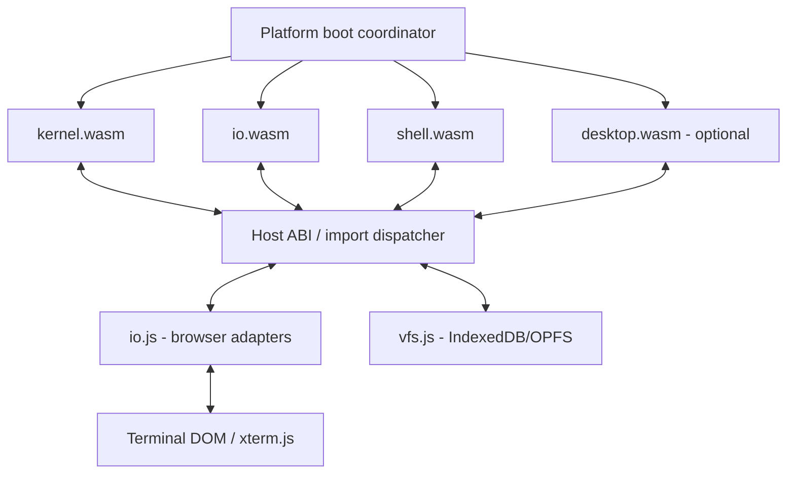

# MaiaOS Shell — implementation blueprint

**Status:** structural phase-one grammar validated with the MaiaCC JavaScript generator and collector against representative fixtures. It is not POSIX-conformant and is not a working shell. The reference for comparison is POSIX.1-2017, Shell Grammar, sections 2.10.1 and 2.10.2.

## Architecture



The browser is the real host. Separate WASM modules do not magically share memory or link symbols. Implement a **versioned C ABI** through JS import/export dispatch and copy buffers across separate linear memories. A single shared-memory design is a separate, advanced option requiring compatible toolchains and browser isolation.

The diagram is the target module decomposition. The current browser coordinator is `platform/desktop-web/main.js`; there is no separate `bootloader.js`, and only the kernel, Calculator and Clock guests currently have buildable WASM sources. `io.wasm`, `shell.wasm` and `desktop.wasm` remain planned artifacts. Every C++98 guest is intended to use MaiaCpp AST-strict -> C89 -> MaiaC -> WASM; the LVGL-WASM browser platform module is the only current Emscripten-built module.

## MaiaCC parser generation

The shell grammar source is `apps/shell/maia-shell.ebnf`. Parser generation is owned by the in-repository MaiaCC toolchain (`maiacpp/maiacc`); REx is an internal stage of MaiaCC's EBNF pipeline, not a separate compiler dependency for MaiaOS. The current test runner generates a temporary JavaScript parser and parse-tree collector to validate grammar fixtures. It does not produce `shell.wasm` or implement command execution.

1. Edit only `apps/shell/maia-shell.ebnf` for grammar changes; never hand-edit generated parsers.
2. Use the MaiaCC parser generator from the recursive submodule and regenerate the target parser from EBNF.
3. Run the shell grammar fixtures and validate lexer/parser token and source-offset agreement.
4. Keep the temporary JavaScript parser used by this test harness distinct from the future shell runtime parser/guest.
5. When shell execution is implemented, compile the C++98 guest through MaiaCpp AST-strict -> C89 -> MaiaC -> WASM; do not use Emscripten for `shell.wasm`.

**Important:** the grammar is only a structural subset. It covers basic simple commands, assignments, file redirections, pipelines, AND/OR lists, subshells, brace groups, `if`, `while`, `until`, and `for`. It does not yet cover `case`, function definitions, here-document bodies, or POSIX word expansion. Its quoted-word lexer is deliberately limited. It also treats reserved words globally and recognizes digit-only tokens as `IO_NUMBER` without checking that they are adjacent to `<` or `>`; POSIX 2.10 requires parser-context classification for reserved words, `NAME`, `ASSIGNMENT_WORD`, and `IO_NUMBER`. These cases require a stateful/context-aware scanner or parser integration, not a change to the grammar productions alone. No POSIX-conformance claim should be made until those rules are implemented and differentially tested.

The current grammar was generated to a temporary JavaScript parser with MaiaCC and exercised through `ParseTreeCollector`. Valid fixtures covered simple commands, assignments, redirections, pipelines, AND/OR lists, comments, quoting, compound groups and loops. Invalid fixtures covered repeated separators and adjacent pipeline operators. This verifies generation and the declared subset only; it does not replace the POSIX lexical-convention rules.

The test runner reads this exact `maia-shell.ebnf` file and regenerates the temporary JavaScript parser on every run. This is the active grammar source. MaiaCC also emits a C++98 parser from it; the generated C++98 source passed `clang++ -std=c++98 -fsyntax-only`, then MaiaCpp AST-strict -> MaiaC -> WASM. The generated WASM exports the parser routines, but the parser consumes tokens supplied by its caller: a runtime lexer, token feeding, parse-tree/AST handling, and command executor still need integration. Do not change the EBNF merely to match an unimplemented executor.

## Fast usable MVP recommendation

Do **not** make a separate `io.wasm` a prerequisite for the first shell. The current browser host already instantiates app guests, schedules their step exports, routes events, enforces manifest capabilities, and provides `maia.vfs.open/read/write/close`. Add a small nonblocking TTY service to that host and launch the shell as a normal app guest beside the kernel. Keep `io.wasm` as a later service split after its contract and IPC are proven.

The first TTY contract should be deliberately small and nonblocking, for example:

| Import | MVP behavior |
|---|---|
| `maia.tty.poll_line(out_ptr, capacity) -> i32` | Return queued UTF-8 bytes, `-6` when no complete line is ready, or a negative status on error. The browser queues lines submitted from a terminal input control. |
| `maia.tty.write(stream, ptr, len) -> i32` | Copy UTF-8 output to the terminal view; `stream` distinguishes stdout and stderr. |

This is a proposal, not part of ABI v0. Before implementation, add both imports to the capability map, host policy, manifest, bounds checks, and host tests. The guest must return from every `shell_step` when no input is available; it must never block the browser event loop. `maia.log.write` remains diagnostics, not user-facing shell output.

Reuse the current VFS API for reading existing files. The current ABI does **not** provide directory enumeration, `mkdir`, `unlink`, `chdir`, pipes, process spawn, or terminal descriptors. Therefore the first command set should be limited to `help`, `echo`, shell-local `pwd`, `cat /system/welcome.txt`, and `exit`. Add `ls`, writable files, `cd`, redirection, and pipelines only with their required VFS/process contracts and tests. The commands in the future inventory below are not implemented by listing them here.

The first shell can use the existing app lifecycle (`maia_app_start` plus `maiaos_step`) and a new app manifest. Its parser should come from MaiaCC and its C++98 runtime should use MaiaCpp AST-strict -> C89 -> MaiaC -> WASM. The initial parser integration spike should compile the generated C++98 parser through MaiaCpp and run a parse fixture in WASM; successful MaiaCC generation alone is not enough evidence.

## Rough implementation cost

Estimates assume one engineer familiar with the Maia Suite, the current browser host, and a deliberately small browser-first MVP. They exclude hardware bring-up and full POSIX conformance.

| Stage | Scope | Rough effort |
|---|---|---|
| Parser integration spike | Add a runtime lexer/token feed and execute parse fixtures through the generated WASM parser. The generator and MaiaCpp/MaiaC compilation path have already been proven. | 1-2 days, depending on token API and lexer behavior. |
| TTY host path | Terminal input/output UI, nonblocking line queue, `maia.tty` imports, capability mapping and browser/Node tests. | 1-2 days. |
| Minimal shell guest | Manifest, app lifecycle, parser/AST command dispatcher and the five MVP commands above. | 2-4 days after the parser spike. |
| File-system commands | Add `readdir`/directory operations, path working directory and tests before implementing `ls`, `mkdir`, `cd`, writes and redirection. | 2-5 additional days depending on the VFS contract. |
| Separate `io.wasm`, pipes and POSIX expansion/jobs | Introduce service IPC, scheduling/backpressure, quoting/expansion, process lifecycle and broader conformance tests. | Several weeks; not an MVP prerequisite. |

The cheapest vertical slice is therefore **current kernel + host TTY service + shell app**, not kernel + `io.wasm` + shell + desktop. The browser host is already the boot/runtime coordinator for this slice. The Espressif bootloader remains unchanged; native MaiaOS firmware is a later target.

## Parser test runner

The runner regenerates the JS parser into the OS temporary directory, parses the scenario corpus, checks expected production rules, and compares every parse-tree terminal with the lexer's token stream and source offsets. Generated parser files are removed when the run ends.

Point `MAIACC_ROOT` at the in-repository MaiaCC submodule, then run the suite:

```sh
MAIACC_ROOT="$PWD/maiacpp/maiacc" npm run test:shell-grammar
```

Print every accepted fixture tree, or inspect a script/command directly:

```sh
MAIACC_ROOT="$PWD/maiacpp/maiacc" npm run test:shell-grammar -- --print-trees
MAIACC_ROOT="$PWD/maiacpp/maiacc" npm run test:shell-grammar -- --file apps/shell/tests/fixtures/demo.sh
MAIACC_ROOT="$PWD/maiacpp/maiacc" npm run test:shell-grammar -- --input 'echo hello | wc -l'
```

The default run reports known POSIX lexical gaps separately. Add `--strict-posix` to make those gaps fail the command while contextual tokenization remains unfinished.

## Parsing semantics

Long-term stages are: browser input -> incremental lexer -> MaiaCC-generated parser -> AST -> expansions -> executor -> MaiaOS ABI. The MVP only needs simple command words, quoting supported by the current grammar, and command dispatch. Defer heredocs, POSIX-context-sensitive reserved words, full assignment semantics, expansions, shell functions, `trap`, and job control. `cd`, `export`, `unset`, `set`, `read`, `shift`, and `umask` require persistent shell state and are not part of the first command slice.

## Future terminal and asynchronous stdin design

For the MVP, use a simple DOM terminal/input control owned by the browser platform host. Keyboard submission queues a UTF-8 line for `maia.tty.poll_line`; output is copied through `maia.tty.write`. This avoids asyncify/JSPI and does not require a Worker or `io.wasm`.

Later, `io.wasm` may own canonical editing, echo, line discipline, and fd 0/1/2. If introduced, it needs an explicit asynchronous ABI and a process/IPC design. **Do not synchronously block the browser main thread.** A coroutine/state-machine API or Worker may be evaluated after the simple host TTY is usable.

## Long-term host ABI proposal

`maia_open(path, flags, mode) -> fd`; `maia_close(fd)`; `maia_read(fd, ptr, len) -> ssize_t/pending`; `maia_write(fd, ptr, len)`; `maia_seek(fd, off, whence)`; `maia_stat(path, out)`; `maia_readdir(fd, out)`; `maia_mkdir(path, mode)`; `maia_unlink(path)`; `maia_rename(old,new)`; `maia_chdir(path)`; `maia_getcwd(out,len)`; `maia_clock_gettime(...)`; `maia_spawn(...)`; `maia_wait(...)`; `maia_pipe(...)`; `maia_dup2(...)`; `maia_tty_ioctl(...)`.

This broad POSIX-like proposal is **not** the ABI to implement for the MVP. It overlaps the existing `maia.vfs` imports and includes unsupported process, pipe, directory, and terminal calls. Prefer the existing VFS signatures plus only the two narrow `maia.tty` calls above. Revisit this broader interface only when there is a real consumer for the additional operations.

## Virtual filesystem

Mount `/` (root), `/bin` (commands), `/home/guest`, `/tmp`, `/dev` (tty/null/zero), `/proc` (synthetic, optional). `vfs.js` maintains inodes, directories, metadata, symlinks (phase 2), file handles and mounts. Start with memory backend, add OPFS/IndexedDB persistence and transactional error handling. Never treat browser storage as a real host POSIX filesystem. `cwd` is per-process; `cd` does not change the browser URL.

## Future command inventory (not implemented)

The phase labels below are prioritization only; none of these commands is implemented by the grammar test. The first MVP command subset is listed above.

**Future shell builtins:** `:`, `.`, `alias`, `bg`, `break`, `cd`, `command`, `continue`, `echo`, `eval`, `exec`, `exit`, `export`, `false`, `fg`, `getopts`, `hash`, `jobs`, `kill`, `pwd`, `read`, `readonly`, `return`, `set`, `shift`, `test`, `[`, `times`, `trap`, `true`, `type`, `ulimit`, `umask`, `unalias`, `unset`, `wait`.

**Core utilities, phase 1:** `basename`, `cat`, `clear`, `cmp`, `cp`, `cut`, `date`, `dirname`, `env`, `expr`, `find`, `grep`, `head`, `id`, `ln`, `ls`, `mkdir`, `mktemp`, `mv`, `printf`, `rm`, `rmdir`, `sed`, `seq`, `sleep`, `sort`, `stat`, `tail`, `tee`, `touch`, `tr`, `uname`, `uniq`, `wc`, `which`, `xargs`, `yes`.

**Phase 2 (depending on kernel support):** `awk`, `chmod`, `chown`, `dd`, `df`, `du`, `file`, `gzip`, `gunzip`, `less`, `more`, `od`, `paste`, `ps`, `tar`, `time`, `timeout`, `top`, `tty`, `vi`.

**Not promised:** real OS processes, native fork/exec, signals, networking, users/groups, device permissions or complete BusyBox behavior. These need explicit emulation or capability mapping. A command name in the inventory is a target, not an implemented feature.

## Future implementation roadmap

1. Boot: loader instantiates modules and checks ABI versions; terminal prints `MaiaOS>`.
2. TTY: editable input line, stdout/stderr, Ctrl-C/Ctrl-D, multiline continuation.
3. VFS: memory filesystem, fd table, `/home/guest`, basic read/write/list operations.
4. Parser: validate grammar and generated C++; AST for words, simple commands, pipelines, redirections.
5. Executor: `echo`, `pwd`, `cd`, `ls`, `cat`, `mkdir`, `touch`, `rm`, `exit`.
6. Jobs: pipe buffers with backpressure; cooperative tasks and `wait`; no false claims of POSIX fork.
7. Shell language: variables, quoting, expansion, if/for/while/functions, substitutions, heredocs.
8. Persistence and GUI: OPFS/IndexedDB and optional `desktop.wasm` terminal window.
9. POSIX conformance: build fixtures from the Open Group shell specification and differential-test against `dash`/BusyBox `ash` where semantics are comparable.

## Future shell acceptance criteria

`echo hello`; `pwd`; `mkdir demo; cd demo; echo hi > a.txt; cat a.txt`; `echo abc | tr a-z A-Z`; `false || echo recovered`; `printf 'a\nb\n' | wc -l`; `read name` (type at terminal); multiline input; Ctrl-C; EOF; reload and recover persisted file. Verify exit codes, stderr, ordering, no UI freeze, no dropped bytes, no parser hang on malformed input, and ABI mismatch detection.

## References

- POSIX.1-2017 Shell Grammar, lexical conventions and grammar rules: https://pubs.opengroup.org/onlinepubs/9699919799/utilities/V3_chap02.html#tag_18_10
- POSIX shell grammar source for study: https://gist.github.com/Chubek/42ec6e7b65d17888eeaaaad50738bff9
- REx: https://github.com/GuntherRademacher/rex-parser-generator
- POSIX Shell Command Language: https://pubs.opengroup.org/onlinepubs/9799919799/utilities/V3_chap02.html
- BusyBox: https://busybox.net/
