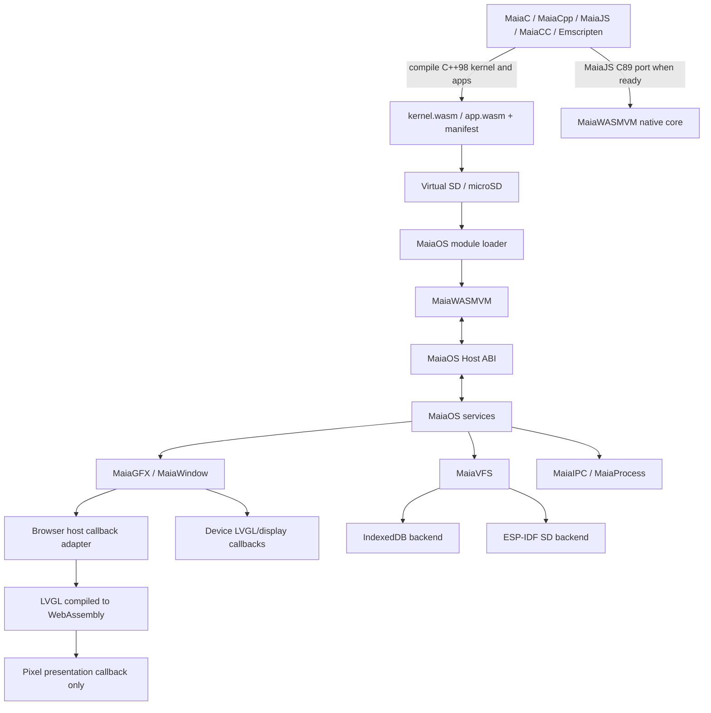
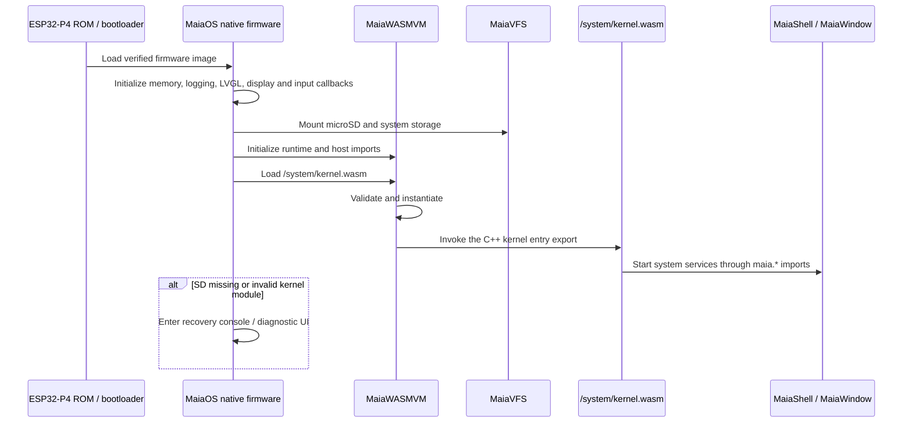
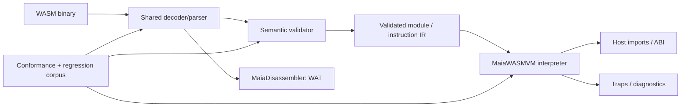
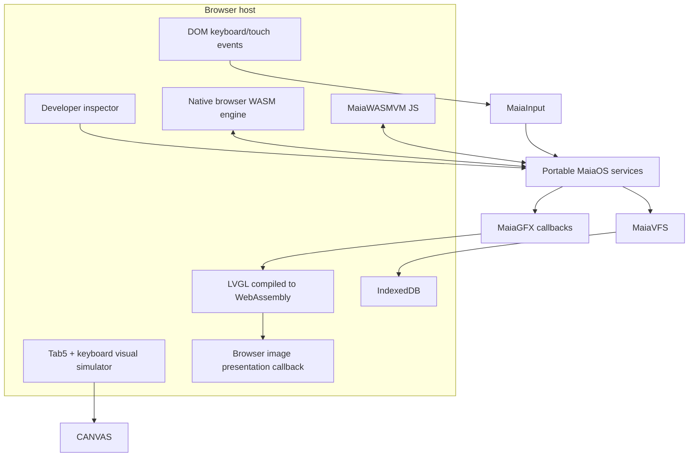
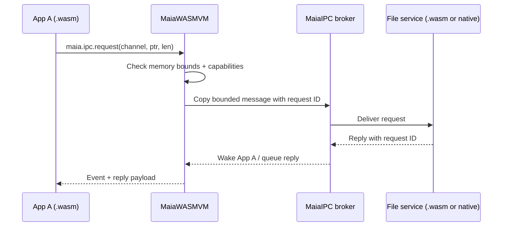
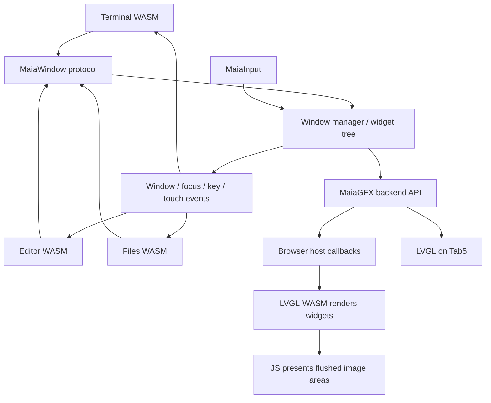

# MaiaOS — Updated Architecture, Product Vision and Implementation Plan

**Version:** 0.2 (architecture proposal)  
**Date:** 2026-10-17  
**Status:** Design baseline; not an implementation-complete specification  
**Target:** M5Stack Tab5 / ESP32-P4, with keyboard accessory; browser simulator first  
**Languages:** C++98 for the initial MaiaOS kernel guest; JavaScript ES8 for MaiaWASMVM development and browser callbacks; C89 generation remains a separate VM/device portability path. WebAssembly 3.0 is a target with an explicitly constrained embedded execution profile.

> This document consolidates the MaiaOS decisions made after the initial GitHub starter package. It supersedes conflicting _architectural intentions_ in earlier notes but does not imply that unimplemented components are working. In particular, **MaiaWASMVM is currently under implementation**, and bugs found in **MaiaDisassembler** are being corrected. Those defects must be tracked and regression-tested, not assumed resolved.

## 1. Executive vision

MaiaOS is a portable WebAssembly-based operating environment for small computers and embedded devices. Its first physical target is the M5Stack Tab5 (ESP32-P4), including the physical keyboard accessory. MaiaOS is designed to become a self-hosted development computer: edit source on the device, compile with Maia toolchain components when feasible, save `.wasm` files to microSD, and run them within isolated WASM instances.

The primary development environment will be a **web-based Tab5 simulator**, which reproduces the screen, keyboard and device controls while running real MaiaOS services and applications. Browser-specific rendering and storage are host adapters, **not** the operating-system API. The same upper layers must be portable to the physical device and a native desktop host.

### Non-goals for the first release

- Replace ESP-IDF, FreeRTOS or the Espressif secure boot chain.
- Provide Linux/POSIX binary compatibility or a conventional MMU-backed process model.
- Implement every WebAssembly 3.0 feature before the first bootable demonstration.
- Execute WAT directly on the RISC-V CPU; WAT is a textual format, not native firmware.
- Guarantee full self-hosted compilation on Tab5 before memory and runtime performance measurements.

## 2. Core architectural principles

1. **One portable ABI:** the C++98 kernel guest and user applications use stable `maia.*` imports, opaque handles, bounded messages and UTF-8 buffers.
2. **VM separate from OS:** MaiaWASMVM knows about modules, validation, linear memory, execution and host imports; it does not depend on LVGL, SD or FreeRTOS.
3. **C++98 kernel guest:** compile the initial kernel directly to freestanding WASM; it calls system services only through imports. Keep MaiaWASMVM's ES8 implementation and C89 device port separate.
4. **Small native host:** ESP-IDF/FreeRTOS, MaiaWASMVM, drivers, LVGL/display integration, storage, recovery, and the device callback table are native.
5. **Replaceable browser host:** while MaiaWASMVM is in progress, browser/Node native WebAssembly executes the same kernel guest; JavaScript supplies the same `maia.*` callbacks.
6. **WASM-first userland:** system programs and services move to `.wasm` as the VM, toolchain and resource budget permit.
7. **Desktop-first development:** browser simulator is the fastest feedback loop; real Tab5 remains the hardware target.
8. **Measured resource budgets:** CPU, PSRAM, stack, framebuffers, file handles, queues and WASM linear memory have explicit limits.
9. **Security boundaries:** validate every module, pointer/offset, imported function, handle, path, message and permission.

## 3. System context



### Layer ownership

| Layer       | Responsibilities                                                    | Portable implementation                                             | Platform-specific implementation                          |
| ----------- | ------------------------------------------------------------------- | ------------------------------------------------------------------- | --------------------------------------------------------- |
| Toolchain   | Compile C++98 kernel/apps to WASM; separately compile ES8/C89 tools | Existing Maia projects; Emscripten for kernel prototype             | Compiler toolchain/host build                             |
| MaiaWASMVM  | Decode, validate, instantiate, execute, trap, import linking        | JS reference; generated C89 or independently checked native backend | Time slices, allocation and task integration              |
| MaiaOS core | Kernel entry, process table, handles, permissions, scheduler policy | C++98 `kernel.wasm` guest                                           | Native boot host and FreeRTOS hooks                       |
| MaiaIPC     | Mailboxes, bounded messages, request/reply, events                  | Shared wire protocol                                                | Queue and synchronization adapters                        |
| MaiaVFS     | Paths, mounts, namespaces, access rights                            | Shared VFS API                                                      | IndexedDB, native FS, microSD                             |
| MaiaGFX     | Windows, widgets, input events, rendering commands                  | Shared graphics protocol                                            | Browser LVGL-WASM callbacks; native device LVGL callbacks |
| MaiaInput   | Keyboard, touch, focus and shortcuts                                | Normalized event model                                              | DOM; Tab5 I2C keyboard/touch                              |
| System apps | Shell, Terminal, Files, Editor, Settings, Monitor                   | WASM userland target                                                | None except through ABI                                   |

## 4. Boot and recovery

**Decision:** the Espressif ROM and second-stage bootloader load a small native platform firmware. That host initializes MaiaWASMVM and platform callbacks, then loads the C++98 kernel guest from `/system/kernel.wasm`. The browser wrapper loads that same artifact using the browser's native WebAssembly engine until MaiaWASMVM is ready. Do not put the interpreter or the full OS into the Espressif second-stage bootloader.



**Reliability rules:** keep an essential recovery environment in firmware/internal flash; detect missing SD and corrupted modules; retain logs and error codes; use watchdog-compatible VM yielding; avoid SD access in the Espressif bootloader. A system manifest selects `kernel.wasm` and its entry export and may define a recovery fallback.

## 5. MaiaWASMVM: current status and implementation strategy

**Known current state:** MaiaWASMVM is being implemented. MaiaDisassembler, written largely in JavaScript, currently converts WASM to WAT and performs validation in the Maia toolchain. Development of the VM has exposed bugs in MaiaDisassembler; fixes are underway. The exact coverage of semantic validation, WebAssembly 3.0 proposals and regression corpus must be audited.

**Recommended reuse:** share the existing decoder/parser logic rather than write a second independent parser without need. Introduce an intermediate representation suitable for both disassembly and execution. Preserve the original JS as a differential reference; compile supported code to C89 with MaiaJS, then build for native desktop and ESP-IDF.



**Mandatory validation gates:** sections and bounds; LEB128 canonical handling where required; instruction decoding; type stack; block/control-flow typing; imports/exports; memory/table limits; function signatures; data/element segments; unsupported feature detection. The decoder alone is not sufficient for safe execution.

**Runtime internals:** operand and call stacks; locals/globals; linear memory and checked growth; tables and indirect calls; control-flow interpreter; host function registry; fuel/instruction budgets; traps; deterministic cleanup. Begin with an interpreter; consider pre-decoded instructions after profiling. AOT/JIT are not MVP requirements.

**WASM 3.0:** target compatibility is distinct from the embedded implementation profile. Initial modules must use `memory32` and a declared supported feature set. GC, Memory64, SIMD, exceptions, tail calls and multi-memory should be enabled only after feature-by-feature implementation and tests. WASM threads/atomics and SMP are separate concerns; do not assume the current disassembler's support implies runtime threading.

**Differential tests:** run identical `.wasm` fixtures through (1) browser-native WebAssembly, (2) JS MaiaWASMVM, (3) native MaiaWASMVM, and (4) ESP32-P4. Compare return values, memory, imports, traps and error categories. Track every discovered MaiaDisassembler bug as a regression fixture before closing it.

## 6. Browser-first Tab5 simulator

The simulator must look like the Tab5 with optional attached keyboard, but it must also function as a genuine host for MaiaOS. The surrounding HTML/CSS represents **device hardware**. MaiaOS guest UI calls platform-neutral `maia.*` imports. The browser host dispatches those callbacks to LVGL compiled as a WebAssembly platform module; LVGL creates widgets and rasterizes them. Its flush callback sends RGB565 rectangles to JavaScript, which only presents those pixels on the browser canvas. The canvas does not draw or simulate widgets. On the device, the same guest imports dispatch to native LVGL and the actual display/input drivers.

### Simulator components

- **Device bezel:** Tab5 silhouette, 1280×720 logical display, responsive scale/zoom, fullscreen mode.
- **Keyboard accessory:** detachable visual layout, clickable keys, host-PC keyboard mapping, modifiers, repeat, shortcuts and configurable mapping to the actual hardware.
- **Touch:** pointer-to-touch translation, coordinates, press/release, gestures where supported.
- **Virtual microSD:** persistent VFS via IndexedDB; import/export a filesystem archive or image using a documented format.
- **Guest runtime selector:** browser-native WASM reference vs MaiaWASMVM JS. LVGL-WASM is a separate browser platform service, not the MaiaOS guest runtime.
- **Developer diagnostics:** process table, syscall trace, IPC queues, VM traps, memory quotas, VFS explorer and event monitor, outside the device screen.
- **Fault injection:** SD removal, I/O failures, low memory, invalid module, blocked process and lost input events.
- **Screen parity:** logical resolution and input coordinates must be identical to the physical target, even if CSS scales the display.



The native browser/Node WebAssembly engine is only a temporary way to execute the C++98 kernel guest while MaiaWASMVM is under implementation. LVGL-WASM is a separate browser platform module; the JS host binds the guest's `maia.*` imports to LVGL callbacks and the wrapper presents flushed pixels. On device, the boot firmware loads the same guest into MaiaWASMVM and binds those imports to native LVGL/driver callbacks. The guest does not select its engine or platform. The web host still cannot prove FreeRTOS timing, physical I2C behavior, PSRAM allocation, or device drivers.

## 7. Process model, scheduling and IPC

A MaiaOS process is initially **one isolated WASM instance** with a process ID, memory quota, handle table, capabilities, mailbox, lifecycle state and execution budget. Multiple instances may be scheduled on different FreeRTOS tasks/cores; that is not equivalent to WASM threads sharing linear memory.

States: `CREATED -> READY -> RUNNING -> WAITING/READY -> EXITED` with `TRAPPED` and `KILLED` terminal paths. A VM execution slice must yield after a bounded fuel count, event wait or host call; long-running loops must not freeze UI or starve the watchdog.

### MaiaIPC v0

- **Message passing by copy**, with bounded payload size, queue depth and sender identity.
- `send(channel, bytes)` for asynchronous delivery; `request(channel, bytes, timeout)` for request/reply; `subscribe(topic)` for event streams.
- Host-facing ABI uses integer handles and `(offset,length)` pairs in guest linear memory; higher-level ES8 SDK exposes promises where available.
- Correlation IDs, protocol versions, error codes, deadlines, cancellation and access controls are required.
- No direct pointers or unrestricted cross-process shared memory in v0.



**Shell streams:** pipes and redirection should be built on bounded byte streams with backpressure, rather than on special ad hoc shell-only mechanisms.

## 8. MaiaWindow and MaiaGFX

The initial window protocol is **widget-command based**, not per-application framebuffers. Applications send commands such as `window_create`, `label_create`, `button_create`, `set_text`, `set_geometry`, `show`, `destroy`. The window service owns widget handles, focus, stacking, clipping, hit testing and event routing. Applications cannot access LVGL pointers directly.



A later surface/canvas extension can support games, scientific plots and media. It must be optional because full 1280×720 RGB565 buffers consume about 1.76 MiB each. Only the designated LVGL task may mutate LVGL objects; other tasks enqueue UI commands.

## 9. MaiaVFS and storage

The same paths and access rules must work in browser, native desktop and Tab5. Suggested mounts:

```text
/system/          signed or trusted system WASM and configuration
/apps/            installed application packages
/home/            user projects, source and documents
/tmp/             temporary bounded storage
/dev/             virtual devices and capability-backed endpoints
/config/          device settings
/logs/            diagnostic logs
```

**Host backends:** browser IndexedDB; desktop filesystem sandbox; ESP-IDF FAT/microSD and flash-backed recovery/config. Mount namespace, path normalization, `..` prevention, per-app permissions, quotas, atomic update strategies and removal/error behavior belong to MaiaVFS. Do not let WASM guests pass host filesystem paths directly.

**App package:** directory or archive with `app.wasm`, `manifest.json`, optional assets and optional signatures. Manifest declares entry point, ABI version, required WASM features, memory limits and requested capabilities. Permission grants are host policy, not automatically granted by manifest claims.

## 10. Shell language and development environment

**MaiaShell** uses a small Unix-inspired command grammar (`ls`, `cd`, `cat`, `ps`, `kill`, `maia run`, `maia cc`) and structured pipelines eventually. **ES8** is the high-level scripting language, compiled to WASM by MaiaJS when supported. The shell parser and JavaScript execution are distinct components; the shell does not require embedding a full JS engine.

**Maia IDE** on Tab5 will support physical keyboard input, file browser, editor, syntax highlighting, save/open, integrated terminal, build/run commands and diagnostics. Stages: remote compilation from PC; on-device editing with externally built WASM; on-device Maia compiler execution (conditional on RAM/performance feasibility).

### Proposed system application catalog

| Application / service  | Function                                      | Priority |
| ---------------------- | --------------------------------------------- | -------- |
| Maia Init              | Load system services and desktop              | P0       |
| MaiaWindow             | Window manager, widget tree, focus and events | P0       |
| MaiaShell              | Desktop, launcher and session controls        | P0       |
| Maia Terminal          | Command interpreter and terminal view         | P0       |
| Maia Files             | Browse/copy/move/manage files                 | P0       |
| Maia Editor / Maia IDE | Source editing and later compile/run          | P0/P1    |
| Maia Settings          | Display, keyboard, storage and preferences    | P1       |
| Maia Monitor           | Processes, memory, queues and CPU diagnostics | P1       |
| Maia Package           | Install/remove WASM app packages              | P1       |
| Maia Developer Console | Disassembler, VM traces and debugging         | P1       |
| Maia Calculator        | Small end-to-end WASM UI reference app        | P0       |
| Maia Network           | Network diagnostics and configuration         | P2       |
| Maia Media             | Image/audio/video viewers as hardware permits | P2       |
| Maia Update            | Safe firmware/system application updates      | P2       |
| Maia Clock             | Clock, timers and alarms                      | P2       |

Priorities: P0 = first usable system; P1 = developer workstation; P2 = expanded product.

## 11. ESP32-P4 / Tab5 hardware integration

ESP-IDF is the primary firmware framework, with Arduino usable for hardware experiments or as a component where practical. FreeRTOS provides the native task scheduler. LVGL drives the display; a platform adapter translates MaiaGFX commands. The Tab5 keyboard accessory is integrated through an I2C driver and MaiaInput event normalization; exact protocol/mapping and electrical pin configuration must be verified against the purchased keyboard revision and official examples before implementation.

**Memory:** reserve separate budgets for firmware, graphics, interpreter state, per-process WASM linear memory, queues, caches and filesystem. Begin with conservative per-process quotas and instrument actual PSRAM use. No assumption that all 32 MB PSRAM is continuously available to guest WASM. Avoid large per-process framebuffers.

**Core usage:** one designated graphics task; VM workers may execute independent instances across CPU cores. Synchronize broker queues and handle tables. Do not equate hardware SMP with shared-memory WASM threads.

## 12. Proposed repository structure

```text
maiaos/
  README.md
  docs/
    MAIAOS_ARCHITECTURE_VISION_2026.md
    architecture/           # runtime, boot, process, IPC, graphics, VFS
    specifications/         # ABI, WASM profile, package format, protocols
    decisions/              # architecture decision records
    planning/               # milestones, status, risks, integration
    testing/                # conformance and device test plans
    product/                # system applications and UX
  runtime/
    experimental/           # existing prototype
    maiawasmvm/             # proposed integration of MaiaWASMVM
  components/
    maia-gfx/
    maia-vfs/
    maia-ipc/              # planned
    maia-window/           # planned
    maia-input/            # planned
  platform/
    desktop-web/           # existing browser prototype
    desktop-native/        # planned LVGL/SDL host
    esp32p4/               # planned firmware
  simulator/
    web/                   # planned Tab5 bezel, keyboard, debugger
  apps/
    system/                # planned system applications
    examples/
  tests/
    conformance/           # planned WASM differential corpus
    integration/           # planned ABI / IPC / graphics / VFS
    hardware/              # planned Tab5 tests
  scripts/
```

The folders marked **planned** are not asserted to exist in the starter package.

## 13. Milestones and acceptance criteria

| Milestone               | Deliverable                                                                                   | Acceptance evidence                                                    |
| ----------------------- | --------------------------------------------------------------------------------------------- | ---------------------------------------------------------------------- |
| M0 — Baseline           | Audit existing MaiaJS, MaiaWASMVM and MaiaDisassembler; collect bugs                          | Reproducible test corpus and capability matrix                         |
| M1 — Simulator shell    | Tab5 web silhouette, optional keyboard, LVGL-WASM screen, host callbacks and diagnostic panel | LVGL renders widgets; image flush and input/event callbacks pass tests |
| M2 — ABI prototype      | Host imports, VFS, window protocol, IPC contracts                                             | Calculator/Terminal sample works on browser reference engine           |
| M3 — VM parity          | MaiaWASMVM JS executes selected generated modules                                             | Results and traps match browser-native WebAssembly                     |
| M4 — Native portability | MaiaJS-generated C89 runtime runs on PC                                                       | Differential tests match JS reference; memory profiling                |
| M5 — Device graphics    | Native LVGL/display-task callback adapter implementing MaiaGFX                                | Same guest and callback semantics as browser LVGL-WASM host            |
| M6 — Tab5 boot          | ESP-IDF host boots MaiaWASMVM, mounts SD, loads C++98 `kernel.wasm`                           | Real hardware demo with touch, keyboard and recovery path              |
| M7 — Developer desktop  | Files, Terminal, Editor, Shell, Monitor                                                       | Write/save/open source and execute precompiled WASM on Tab5            |
| M8 — Self-hosting       | Maia compiler runs on Tab5 if feasible                                                        | Compile, save and run a new `.wasm` without PC                         |

**First vertical slice:** compile `apps/kernel/kernel.cpp` to `kernel.wasm` → instantiate it with the browser's native WASM engine and JS `maia.*` callbacks → create a label/button through LVGL-WASM → route an input event back into the C++ guest → load the identical guest through MaiaWASMVM/device callbacks when available. Keep callback parity and VM conformance as separate test results.

## 14. Testing, quality and security

- Regression suite for all MaiaDisassembler bugs uncovered during MaiaWASMVM implementation.
- Positive and negative WebAssembly fixtures, including malformed sections, invalid type stacks, invalid memory accesses and unsupported feature declarations.
- Differential execution tests against a standards-compliant browser engine, distinguishing engine-specific limits from spec semantics.
- Property/fuzz tests for decoder, binary bounds, path normalization and IPC packets.
- Host ABI tests for pointer bounds, buffer length, stale handles, permissions and error propagation.
- Graphics golden scenarios: focus, z-order, resize, keyboard, touch and widget destruction.
- Fault injection for microSD removal, full disk, low memory, blocked queues, infinite guest loops and crash recovery.
- Performance telemetry: instructions/second, latency per frame, input-to-render delay, heap/PSRAM peaks, module load time and per-process memory.
- CI matrix for JS reference, generated C89 and desktop hosts; hardware smoke tests when device connected.

## 15. Risks and explicit open decisions

| Risk / question                                        | Initial mitigation or decision                                                                |
| ------------------------------------------------------ | --------------------------------------------------------------------------------------------- |
| MaiaDisassembler bugs affect VM correctness            | Fix upstream; add regression fixtures and cross-engine tests                                  |
| ES8 → C89 translation may require expensive JS runtime | Audit actual feature usage; keep VM hot path compact; measure generated output                |
| WASM 3.0 feature coverage exceeds device budget        | Publish feature-gated embedded profile; reject unsupported modules                            |
| Browser LVGL-WASM and device LVGL versions differ      | Pin compatible LVGL versions, keep the callback ABI narrow, and compare raster/event behavior |
| Keyboard mapping or firmware revision differs          | Verify official accessory protocol and test actual hardware                                   |
| Shared-memory SMP complicates VM                       | Start with isolated instances and message passing                                             |
| On-device compilation exceeds PSRAM/time budget        | Stage remote compilation, then local compilation as research milestone                        |
| Userland services cannot start without SD              | Firmware-level recovery shell and essential flash fallback                                    |
| Browser-native WASM hides VM defects                   | Always compare against MaiaWASMVM JS and native execution                                     |
| ABI drift between C, C++ and JS SDKs                   | Single versioned ABI schema and generated bindings                                            |

**Still to decide:** precise WASM 3.0 embedded feature list; VM fuel granularity; binary IPC wire format; package signing policy; display theme and final keyboard layout; whether first P0 services are native JS host modules or WASM processes; filesystem archive format; long-term package/update trust model. These should be tracked as ADRs rather than silently fixed by prototype code.

## 16. Immediate implementation checklist

1. Inventory MaiaWASMVM and MaiaDisassembler code, tests, known defects and supported instructions.
2. Freeze a minimal cross-platform `maia.*` ABI for logging, time, VFS, input and widget creation.
3. Build the freestanding C++98 kernel guest and load it through the browser reference wrapper.
4. Implement the browser host callbacks (LVGL-WASM renderer, flush-image presentation, detachable keyboard and external inspector).
5. Wire keyboard and touch to normalized MaiaInput events.
6. Add IndexedDB-backed MaiaVFS with virtual SD import/export and failure simulation.
7. Create WASM fixtures compiled by MaiaC and MaiaCpp; record browser reference outputs.
8. Integrate MaiaWASMVM JS at the runtime boundary without changing kernel imports or LVGL callbacks.
9. Integrate the generated C89 VM into device firmware only after comparing it with the JS VM implementation.
10. Build a minimal calculator and terminal app through the ABI, not through direct DOM calls.
11. Track performance and RAM from the first end-to-end execution.

## 17. Relation to original starter package

This document is a **design update** to the original `MaiaOS_GitHub_Starter.zip`. The starter already contains a browser desktop prototype, a minimal experimental JS VM, draft ABI/VFS/GFX APIs and architectural notes. It is **not** yet the full Tab5 hardware simulator, a WebAssembly 3.0 interpreter, a complete window manager or an ESP32-P4 firmware. The workstreams above identify the next implementation steps and the tests required to promote design intentions into working capabilities.

---

**Proposed product statement:** _MaiaOS is a portable, WebAssembly-based operating environment with a browser-first Tab5 simulator and a path toward a self-hosted RISC-V development computer._
