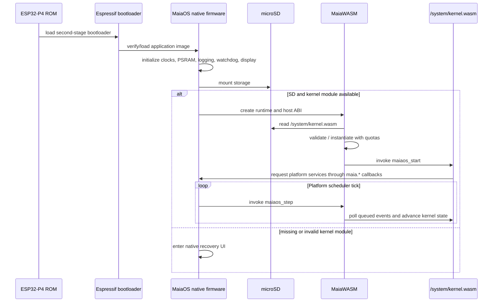

# Boot and recovery

## Bootloader, platform host, and MaiaOS guest

The Espressif ROM and second-stage bootloader load the native platform firmware. That firmware provides MaiaWASMVM, LVGL/display drivers, recovery, and the device callback table; the C++98 MaiaOS kernel itself is `/system/kernel.wasm`, compiled to WASM and loaded by the platform boot coordinator. The guest sees only the `maia.*` ABI. The browser wrapper follows the same contract but temporarily uses the browser's native WebAssembly engine. Do not put a second hardware-independent copy of display/services into the guest.

## Target guest artifacts and current status

The bootloader is not a replacement for the Espressif chain. On device, the target is Espressif ROM/second-stage bootloader -> native MaiaOS platform firmware/boot host -> `kernel.wasm`. In the browser, `platform/desktop-web/main.js` currently coordinates startup; a separate `bootloader.js` is not implemented.

| Artifact | Status | Build/source |
|---|---|---|
| `kernel.wasm` | Implemented | `apps/kernel/kernel.cpp`, C++98 -> MaiaCpp AST-strict -> C89 -> MaiaC -> WASM. |
| `io.wasm` | Planned | Future I/O/TTY service; no guest source or build target yet. |
| `shell.wasm` | Planned | Future command shell; only its EBNF/parser test prototype exists. |
| `desktop.wasm` | Planned | Future graphical desktop/session guest; current LVGL browser host is a separate platform module. |

Calculator and Clock are implemented example app guests built by the same MaiaCpp -> MaiaC pipeline. MaiaCpp, MaiaC, MaiaCC and MaiaWASM are consumed from the recursive MaiaOS `maiacpp` submodule. Emscripten builds the separate LVGL-WASM browser module only; it does not compile the kernel or apps.

## Storage policy

- Flash: signed/verified firmware (when secure boot is configured), recovery UI, configuration and optional minimal rescue app.
- microSD: `/system/kernel.wasm`, app packages, user data, logs and non-critical assets.
- SD may be removed or corrupted: boot must enter recovery without a working filesystem.
- Atomic updates: write temp files, verify checksum/signature if enabled, rename; preserve previous bootable init.
- Secure boot and flash encryption are separate deployment features, not assumed enabled.

## Boot stages

0. ROM and second-stage bootloader (Espressif maintained).
1. Native MaiaOS platform startup, drivers, SD, display and diagnostics.
2. Instantiate MaiaWASM and register `maia.*` host functions.
3. Load and validate `/system/kernel.wasm`; invoke the manifest-selected `maiaos_start` export.
4. Schedule `maiaos_step` and bind every `maia.*` import to device callbacks; failure falls back to native recovery.

The boot module's manifest is a capability request, not authorization. Define explicit privileged capabilities and host policy.
