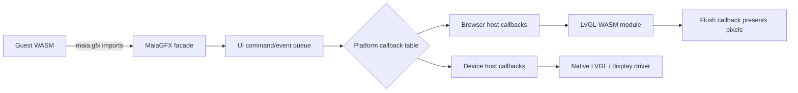

# Graphics, events and virtual filesystem

## MaiaGFX

Guest imports use integer handles and memory offsets/lengths. Initial ABI is a **retained-mode UI** with windows, labels, buttons and event callbacks by event queue. The host validates ownership and type of every handle. The VM does not expose `lv_obj_t *` or any native pointer.

The MaiaOS guest is platform-agnostic and calls only `maia.*` imports. The browser wrapper dispatches them to LVGL-WASM callbacks; on the device, firmware dispatches the same imports to native LVGL and the display/input drivers. The browser presentation callback receives RGB565 areas already rasterized by LVGL and copies those pixels to the HTML canvas; the canvas does not draw widgets. The host also normalizes touch/keyboard events and routes LVGL events back to the guest.

LVGL is initialized and ticked by the platform host. The browser uses `requestAnimationFrame`; device firmware schedules LVGL on its designated task. Do not put platform detection into the MaiaOS guest. No concurrent LVGL mutation from VM workers. Use logical coordinates and DPI-aware layout; do not expose `lv_obj_t *` or host pointers through the guest ABI.

## MaiaVFS

Initial mounts: `/system` (read-only to normal apps), `/apps` (installed packages), `/home/<app-id>` (private writable data), `/tmp` (volatile), `/shared` (permission-controlled). Paths are normalized and checked against root traversal. VFS adapters bind an app ID and deny access to another app's `/home` subtree. The browser host hydrates only that app's home subtree plus `/shared` from IndexedDB, keeps synchronous operations in a bounded memory cache, and persists mutations asynchronously. `/tmp` and the Node reference adapter remain in memory only. Device microSD/FAT is a future host. Handle-based I/O, quotas and open-file limits are required.

## Event model

Each application owns an event queue. `maia.events.poll` yields events: UI click, key, touch, timer, app message, filesystem notification and shutdown. Events are copied into guest memory after checking buffer bounds. Callbacks may be added later; polling is simplest for v0.

## Backend options

1. **Browser LVGL-WASM host** for shared guest callback and rendering tests (implemented prototype).
2. **Native LVGL desktop host** for optional device-driver and desktop integration tests (planned).
3. **ESP-IDF LVGL** using the Tab5 BSP and the exact display/touch drivers matched to the hardware revision (planned).

There is no assumption that a supported LVGL-for-JS binding exists. A JS facade with a native LVGL backend is preferable to coupling OS APIs to one binding.
