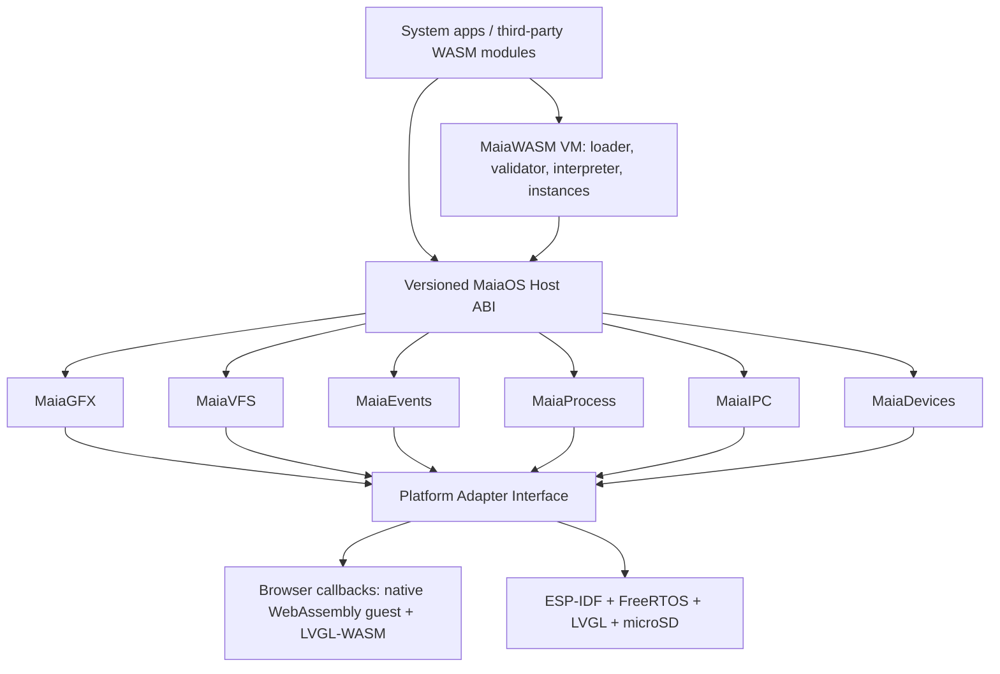

# System architecture

## Core boundaries

**Runtime**: reads binaries, performs structural + semantic validation, resolves imports, instantiates memories/tables/globals, executes instructions and reports traps. No platform includes.

**System**: owns application lifecycle, resource limits, capabilities, events, VFS namespace and graphics object handles. No guest receives raw host pointers.

**Platform**: implements display, touch, monotonic clock, file I/O, synchronization, networking and reboot using platform APIs.

**MaiaOS guest and applications**: the initial kernel guest is written in C++98 and compiled to `/system/kernel.wasm`; user applications are also `.wasm` modules plus manifests. The native platform boot host loads the kernel through MaiaWASMVM; a recovery firmware UI remains available if storage or the guest fails.

## Execution options

- **Development**: browser or Node native WebAssembly engine as a temporary reference backend, with LVGL as the UI renderer. Browser JavaScript only presents LVGL's flushed image buffers; it does not draw widgets. This is not evidence of MaiaVM correctness.
- **Conformance**: MaiaWASM ES8 interpreter running under Node and compared against reference execution.
- **Device**: boot/firmware loads the MaiaOS WASM guest; the host supplies the same `maia.*` callbacks through native LVGL, drivers, and services. MaiaWASMVM replaces the native reference engine when its implementation is ready. Build integration is a pending proof point.

## Core vs. OS

ESP-IDF/FreeRTOS owns hardware interrupts and native tasks. MaiaOS is a sandboxed application environment rather than a bare-metal general-purpose kernel. No assumption of MMU or process address-space isolation.
