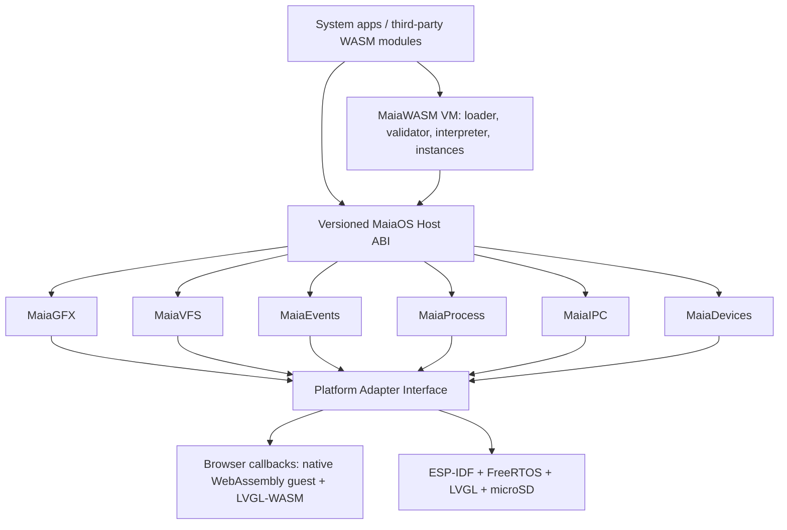

# System architecture

## Core boundaries

**Runtime**: reads binaries, performs structural + semantic validation, resolves imports, instantiates memories/tables/globals, executes instructions and reports traps. No platform includes.

**System**: owns application lifecycle, resource limits, capabilities, events, VFS namespace and graphics object handles. No guest receives raw host pointers.

**Platform**: implements display, touch, monotonic clock, file I/O, synchronization, networking and reboot using platform APIs.

**MaiaOS guest and applications**: the implemented kernel guest is written in C++98 and compiled to `/system/kernel.wasm`; Calculator and Clock are C++98 WASM example apps with manifests. C++98 guests use MaiaCpp AST-strict -> C89 -> MaiaC -> WASM, with MaiaCC and MaiaWASM from the recursive in-repository toolchain submodules. `shell.wasm` implements the bounded eight-command MVP with generated lexing/parsing; the real C++98 `io.wasm` owns its LVGL terminal and keyboard editing. Bounded copied-byte streams connect their isolated memories while the kernel keeps stepping. `desktop.wasm` remains planned. The native platform boot host that loads the kernel through MaiaWASMVM remains planned; browser startup currently uses `platform/desktop-web/main.js` and the native browser WebAssembly reference engine.

The shell's filename-expansion stage uses the published in-repository MaiaGlob
library: a MaiaCC-generated C++98 pattern frontend and bounded C89 matcher/walker.
It preserves quoting from the generated shell tree, expands before dispatch,
and accesses only the existing authorized VFS directory imports. The host
transports directory packets and stream bytes; pattern matching and enumeration
remain in the guest. `ls` accepts multiple file/directory operands; `cat` concatenates files sequentially and remains read-only. These additions do not change the public host ABI,
capabilities, stream contract or rendering responsibilities.

The stdout redirection extension adds approved APPEND semantics to existing VFS
flags and requests vfs.write. The shell owns AST interpretation, expansion and
command output state. Host adapters share bounded backing records and serialized
persistence, while retaining separate authorization and handle tables. I/O still
owns LVGL; host JavaScript does not execute commands. See
[the approved output contract](../planning/SHELL_OUTPUT_REDIRECTION.md).

## Execution options

- **Development**: browser or Node native WebAssembly engine as a temporary reference backend, with LVGL as the UI renderer. Browser JavaScript only presents LVGL's flushed image buffers; it does not draw widgets. This is not evidence of MaiaVM correctness.
- **Conformance**: MaiaWASMVM ES8 interpreter running under Node and compared against reference execution.
- **Device**: boot/firmware will load the MaiaOS WASM guest; the host supplies the same `maia.*` callbacks through native LVGL, drivers, and services. MaiaWASMVM replaces the native reference engine when its implementation is ready. The MaiaCpp -> MaiaC guest build is integrated; device firmware/runtime integration remains pending.

## Core vs. OS

ESP-IDF/FreeRTOS owns hardware interrupts and native tasks. MaiaOS is a sandboxed application environment rather than a bare-metal general-purpose kernel. No assumption of MMU or process address-space isolation.

## Kernel-owned pipeline process slice

The C++98 kernel now owns boot IDs, a bounded 16-slot process table, group
reservations, round-robin runnable selection, launch actions, exit aggregation,
rollback and reaping. The reference host stores instances and transports kernel
packets; its runningProcesses set is not the process policy. The shell submits
expanded generated-AST cat pipelines, and separate cat.wasm workers receive
immutable argv and explicitly delegated caller VFS identity. Real I/O/LVGL stays
separate from command execution. General exec/jobs and pipeline redirection are
outside this first slice. See [the approved lifecycle/packet contract](../planning/SHELL_PIPELINE_PROCESS_CONTRACT.md).
